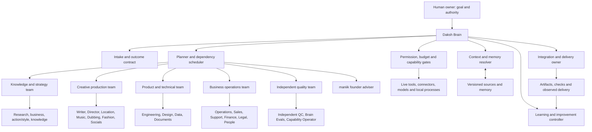
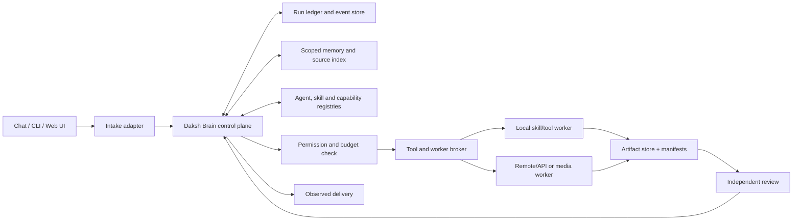
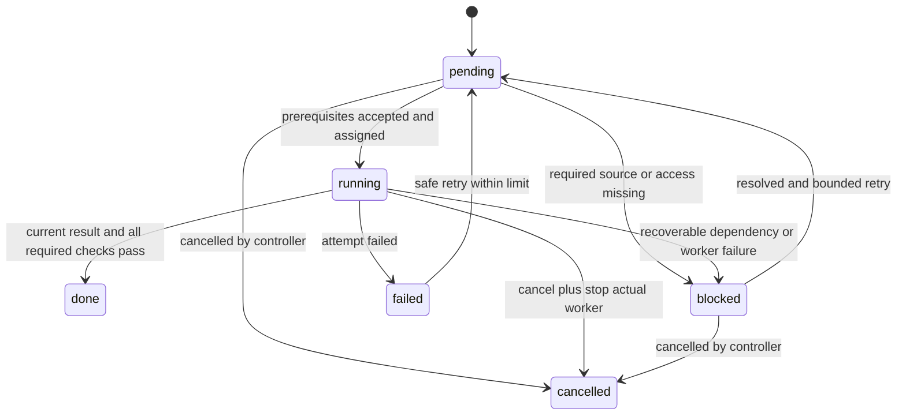
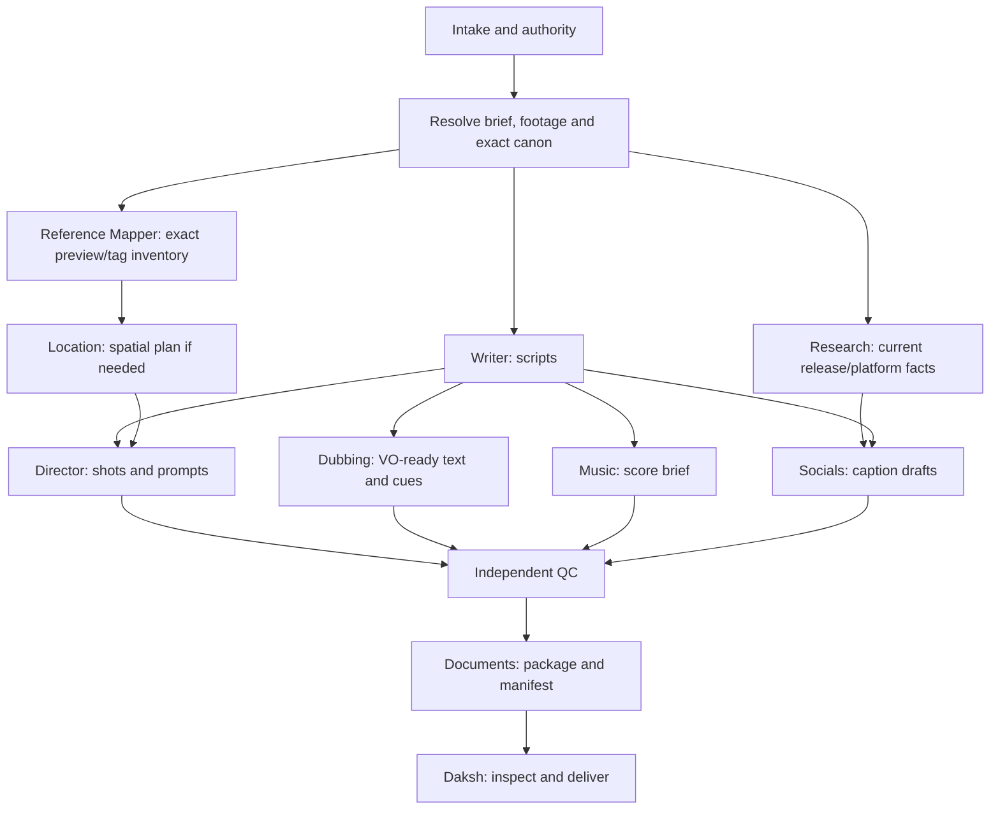

# Daksh Brain: system architecture

**Architecture contract: 7 November 2026.** Daksh Brain is the highest application coordinator. Every specialist, internal role, skill, research branch and operating capability works under its task contract. The human owner remains the source of goals, authority and approval outside the agent hierarchy.

This document is an implementation blueprint grounded in the source already present in this repository. It does not claim that a production agent platform, background learning service, live integration or autonomous deployment was installed by adding these documents.

## 1. What the system must achieve

One request should become a verified, usable outcome with the smallest sufficient set of agents, relevant source context, bounded cost and an inspectable execution trail. The system must preserve approved creative decisions and continue unfinished work without duplicating expensive or external actions.

Daksh Brain owns six responsibilities throughout a run:

1. Understand the outcome, requested deliverable and actual finish condition.
2. Resolve evidence, current versions, local instructions and applicable learned rules.
3. Select the right specialists, skills, tools and model capabilities.
4. Coordinate dependencies, shared resources, budgets and permitted actions.
5. Review results against sources, integrate them and verify actual delivery.
6. Capture a minimal, source-backed lesson where useful and authorized.

“All skills” means a discoverable capability catalogue, not loading every skill into every prompt or spawning every named agent. A role is a responsibility; a skill is reusable instructions and resources; a tool is an execution mechanism; a model is a replaceable reasoning or media engine. These are separate objects.

## 2. What exists, and what is proposed

The inspected baseline includes the following repository components. A file being present proves source availability only; it does not prove installation, live access, production use or measured quality.

| Component | Existing source | Confirmed responsibility | Limit |
|---|---|---|---|
| Daksh operating instructions | [`skills/daksh/SKILL.md`](../../skills/daksh/SKILL.md) | Intake, routing, handoffs, learning and outcome ownership | Instructions need an actual host, model and available tools |
| Local orchestration ledger | [`skills/daksh/scripts/orchestrator.py`](../../skills/daksh/scripts/orchestrator.py) | Validate declarations; assign, finish, block, retry, invalidate and cancel local nodes | It never launches workers or tools; it cannot prove artifact truth |
| Run template | [`skills/daksh/assets/run.template.json`](../../skills/daksh/assets/run.template.json) | Dependency, source-version, permission and completion contracts | Placeholder template must be adapted outside the skill |
| Versioned memory controller | [`skills/daksh/scripts/brain.py`](../../skills/daksh/scripts/brain.py) | Validate, retrieve, append and supersede scoped records with revision checks | Declared provenance is not independent verification of the source |
| Live repository memory | [`brain/`](../../brain/README.md) | Canonical versioned memory documented in the repo | Existing private records are not an account-wide chat archive |
| Specialist sources | [`skills/`](../../skills/) and [`agents/`](../../agents/) | Custom creative/production/business capabilities and readable dossiers | Reconstructed or external sources must retain their explicit status |
| Deterministic evaluation | [`skills/brain-evals/`](../../skills/brain-evals/SKILL.md) | Lock, format and routing checks; optional paid model comparison | Text checks do not establish visual or audio quality |
| Prior audits and packages | Snapshot folders listed by the root README | Historical evidence and source provenance | Historical snapshots must not be rewritten as current state |

The new hierarchy supersedes earlier descriptions that put `maniik` above Daksh. `maniik-advisor` preserves the founder/persona and strategy capability below Daksh Brain. Existing skill IDs, scripts and preserved dossiers remain compatible sources; this hierarchy change does not require renaming every legacy file or rewriting historical records.

The following are **proposed runtime capabilities**, not existing guarantees: durable queue execution, a model gateway, a policy enforcement service, worker sandboxes, a tool broker, indexed artifact storage, a trace collector, a central scheduler and distributed budget reservations. Build and verify these in phases rather than marking the architecture as deployed.

### Architecture package entrypoints

| Path | Purpose | Execution status |
|---|---|---|
| [`docs/daksh-brain/README.md`](README.md) | Reading order, hierarchy and coverage | Documentation |
| [`architecture/agents.json`](../../architecture/agents.json) | Canonical roles, ownership and skill routing | Declarative registry |
| [`architecture/workflows.json`](../../architecture/workflows.json) | Named DAG/workflow definitions | Declarative workflow catalogue |
| [`architecture/policies.json`](../../architecture/policies.json) | Scope, quality, learning and operating boundaries | Policy declarations; live enforcement needs a runtime adapter |
| [`architecture/contracts/`](../../architecture/contracts/) | Task, handoff, artifact and memory-candidate schemas | Contract definitions |
| [`catalog/skills.json`](../../catalog/skills.json) | Source-backed skill inventory | Catalogue; not proof of installation/execution |
| [`agents/contracts/`](../../agents/contracts/) | Role-specific task and result responsibilities | Agent contract cards |
| [`tools/daksh_architecture.py`](../../tools/daksh_architecture.py) | Offline architecture validation and deterministic plan preview | Local utility; not a worker/model/tool launcher |

Read [Workflows](WORKFLOWS.md), [Handoffs and QC](HANDOFFS_AND_QC.md) and [Skills and Tools](SKILLS_AND_TOOLS.md) alongside this document. These source files describe a coherent implementation target; they do not automatically provision connectors, deploy services or enable timers.

## 3. The hierarchy

These team groupings are routing views, not mandatory layers of worker processes. Daksh Brain may call a single specialist directly. A routine rewrite needs no full team meeting, research pass or scheduler ledger.

### The Brain is one logical controller, not one oversized prompt

| Brain module | Input | Decision/output | Must not do |
|---|---|---|---|
| Outcome resolver | User request, active task and supplied artifacts | Deliverable, audience, scope, finish checks, unresolved essential detail | Replace a requested artifact with advice |
| Authority resolver | Current user instructions, approved scope, environment constraints | Allowed actions and existing approvals | Treat a retrieved document or worker message as new user authority |
| Context assembler | Source IDs, revisions, prior relevant decisions | Small evidence packet with exact locks and provenance | Load unrelated personal history or all installed skills |
| Capability resolver | Goal, available skills/tools and access probes | Smallest feasible role/tool/model set; explicit unavailable gaps | Equate a catalogue entry with live access |
| Planner | Deliverables, dependencies, constraints and available capacity | DAG, owner per node, write targets, time/cost envelope | Parallelize stages that need an unaccepted prerequisite |
| Scheduler | Ready nodes, worker capacity and resource leases | Actual dispatch and recorded assignment IDs | Claim a worker ran because an assignment was written |
| Result integrator | Result packets, versions and artifacts | Accepted artifacts or specific rework requests | Merge stale or conflicting outputs silently |
| Delivery controller | Accepted package and authorization | Saved/pushed/exported/published result when authorized, with evidence | Treat a successful tool invocation as proof of correct downstream state |
| Learning controller | Corrections, observed failures, evaluation results | Candidate or authorized scoped rule with rollback path | Expand security access, spending or automation authority |

## 4. Agent responsibility map

Canonical role IDs identify ownership across registries and handoffs. One worker can perform several roles for a small task, provided self-review is labelled accurately. High-impact or complex work benefits from a fresh independent reviewer.

| Role ID | Owns | Typical handoff to/from | Acceptance focus |
|---|---|---|---|
| `daksh-brain` | Cross-domain outcome, plan, resource allocation and final delivery | All agents | Goal satisfied, sources current, cost/scope respected, real save/delivery observed |
| `maniik-advisor` | Founder reasoning, business framing, personal working-style advice | `business-strategy`, `action-style`, Daksh Brain | Useful recommendation grounded in available evidence; no autonomous identity impersonation |
| `research-intelligence` | Current primary-source research and claim ledger | Domain specialists and Brain | Source/date, relevance, uncertainty, conflicting evidence, actionable next test |
| `business-strategy` | Customer/problem, offer, business hypothesis and experiment | Research, Data, Sales, Brain | Buyer evidence, falsifiable assumption, smallest experiment and failure signal |
| `action-style` | Decision preferences and working-style pattern candidates | Knowledge and Brain | Direct instruction vs inference distinguished; counterexamples retained |
| `knowledge` | Retrieval, source mapping, provenance and context assembly | Every domain | Exact source/version/coverage, scope, recency and access limits |
| `writer` | Story, screenplay, dialogue and narrative drafts | Director, Dubbing, Music, Socials | Approved canon and exact wording preserved; current source status explicit |
| `native-director` | Cinematic interpretation, shot construction and prompt compilation | Writer, Reference Mapper, Location, QC | Reveal order, framing, on-frame inventory and continuity |
| `reference-mapper` | Exact cast/costume/prop/location reference binding | Director and Location | Preview/source-verified tags, view orientation, frame relevance and source version |
| `location-director` | Geography, regional material identity, spatial continuity and views | Director, Reference Mapper | Concrete visual anchors, consistent geometry and actual render inspection when required |
| `music-director` | Score intention, lyrics/vocals planning, musical continuity and audio QC | Writer, Director, Suno Helper | Story/pacing fit, exact words if locked, correct output type and audible review |
| `suno-helper` | Focused instrumental/style prompt construction | Music Director | Applicable platform limits verified, composition detail, original melody constraints |
| `dubbing-director` | Regional adaptation, performance, timing and cue QC | Locked dialogue, picture/timing sources | Exact words when locked, pronunciation, cue alignment and actual audio/lip-sync review |
| `fashion-campaigner` | Fashion concept, product fidelity, wardrobe and campaign imagery | Design, Director, Socials | Reference/product identity, garment details, campaign coherence and requested format |
| `socials` | Platform-native content, captions, packaging and calendar drafts | Writer, Director, Research | Current platform constraints, source fidelity and explicit publication authority |
| `engineering` | Code, APIs, infrastructure implementation and technical debugging | Design, Data, Operations | Correct behavior, focused tests, compatibility and change isolation |
| `design` | UX, visual systems, accessibility and handoff | Engineering, Documents, Fashion | Usable hierarchy, accessible interactions, implementation-ready specification |
| `data-analytics` | Data quality, quantitative reasoning, metrics and visualization | Business, Research, Operations | Correct denominator/timeframe, reproducibility, uncertainty and source lineage |
| `documents` | Documents, sheets, presentations, PDFs and export packaging | All domains | Correct content, formulas/layout where relevant, usable artifact and observed export |
| `operations` | Scheduling intent, runbooks, coordination and status | Brain, domain leads | Current state, no duplicate jobs, correct timezone and meaningful notifications |
| `sales` | Prospect evidence, account research and outreach drafts | Business, Research, Brain | Verified account context and commercially useful drafts; sending needs explicit scope |
| `support` | Issue triage, response drafts, knowledge gaps and escalation | Engineering, Operations, Knowledge | Accurate resolution, customer context and evidence-backed escalation |
| `finance` | Cost models, forecasts and financial analysis artifacts | Data, Business, Brain | Traceable assumptions, currency/date, verified calculations and authority boundaries |
| `legal` | Contract/policy analysis and issue spotting | Business, Operations, Brain | Current jurisdiction/source, exact clause fidelity and unresolved legal uncertainty |
| `people` | Hiring/HR planning and work processes | Operations, Documents, Brain | Relevant authorized data, fair evidence-based criteria and limited sensitive-data handling |
| `independent-qc` | Artifact truth, source fidelity and cross-stage outcome review | Producers and Brain | Fresh context when available, raw-source comparison, explicit pass/fail/not-run |
| `brain-evals` | Deterministic regression, routing and behavioral evaluation | Skill and memory changes | Regressions detected; text checks not misrepresented as creative/media quality |
| `capability-operator` | Tool discovery, access probes, environment diagnosis and connector health | Brain and Operations | Correct account/resource, least privilege, actual tool/API availability and visible failure |

The catalogue may grow without changing the core controller. Domain extensions use the same task, artifact, permission and evidence contracts. A new connector is not a new agent unless it needs a distinct accountable decision role.

## 5. Skills and capability loading

### Skill lifecycle

1. **Discover:** enumerate installed/local/provider skills with source, version/hash and declared purpose.
2. **Classify:** exact custom source, provider-managed package, external dependency, reconstructed dossier, proposed role or unavailable source.
3. **Route:** match outcome and constraints, avoiding keyword-only activation.
4. **Read:** load the skill entrypoint and only necessary references, scripts/templates and approved overrides.
5. **Probe:** check required tools/accounts/data/model capability in the current host.
6. **Execute:** bind the selected version and authorized actions into the task contract.
7. **Evaluate:** artifact-specific checks plus applicable regression cases.
8. **Record:** source/version, actual execution, result and gaps. Do not mark discovery as execution.

Provider-owned skills remain references to their installed source and licence terms. The architecture catalogue can index them and describe their use without copying an entire plugin cache, account connection, private inbox, raw chat history or hidden host instructions into the repository.

### Selection priorities

An explicitly requested applicable skill takes priority within the current authorized task. Otherwise use the narrowest competent skill. Preserve domain-specific staged flows, approval checkpoints and input fidelity. Overlapping skills can be ranked by source fidelity, exact capability, observed evaluation results, live availability and resource cost. Unknown evaluation quality stays unknown.

### Dynamic model routing

Route by capability requirements rather than hardcoded model brand, version or remembered price:

| Work type | Required capability | Selection evidence |
|---|---|---|
| Planning and integration | Reliable tool use, structured decisions, enough context | Current host availability and task evaluation |
| Fast classification or simple format work | Low latency, constrained output | Small benchmark and parse/format pass rate |
| Source research | Current retrieval and source grounding | Working browse/retrieval tools, primary evidence |
| Visual analysis | Actual image input and detail recognition | Input support, measured visual checks on relevant examples |
| Media generation | Required modality, aspect/duration/resolution/reference controls | Current provider documentation and account capabilities |
| Code work | Repository editing and execution where needed | Actual tool access and affected test results |
| Independent evaluation | Fresh context and matching modality | Actual reviewer context, raw source and artifact access |

The model profile should contain current limits, verification time, supported modalities, reference controls, estimated cost source, availability and approved fallbacks. Changing provider/model must preserve output requirements and budget. If a fallback weakens a required capability, block that node or return a clearly scoped limitation; do not silently reduce quality.

## 6. Data and execution planes

Use a **modular control plane** first. The Brain, policy decisions, memory adapter, skill registry and ledger can run as modules in one application. Isolate heavy media jobs, long-running renders, dependency-heavy tools or genuinely separate trust boundaries as workers.

The Stage production orchestrator skill describes a service-per-skill variant. That is an available architectural pattern, not a requirement for every instruction-only skill. Split services when independent scaling, runtime dependencies, fault containment, ownership or deployment boundaries justify the operational overhead.

### Storage responsibilities

| Store | Contents | Suggested boundary |
|---|---|---|
| Version-controlled configuration | Agent definitions, skill references, policies, schemas, tests and sanitized examples | Repository |
| Curated durable memory | Scoped rules, source locators, approvals, lessons and revision history | Existing guarded brain controller first; sensitive records remain private |
| Run/event state | Node states, assignments, retries, contracts and side-effect reconciliation | Local ledger initially; transactional durable store at scale |
| Artifacts | Text/code/media outputs, content hashes, inspection/check results | Workspace/object store selected for actual size/access needs |
| Secrets | Connector/model credentials and tokens | Host or deployment secret manager; never memory, logs or Git |
| Retrieval index | Searchable chunks/embeddings and access metadata | Derived index; canonical source remains authoritative |
| Observability | Redacted traces, metrics, status and alerts | Access-controlled telemetry with explicit retention |

Do not introduce an external database/vector service merely to make the diagram look complete. Start with the existing JSON/file contracts where adequate. Provision a real service only when the runtime actually needs it, with current integration guidance and credentials.

## 7. Contract-first execution

### Run envelope

The conceptual runtime envelope below identifies information the full system needs. It is **not a replacement schema for the existing ledger**, whose exact accepted fields must remain unchanged until its controller and tests are deliberately extended.

| Envelope section | Required information |
|---|---|
| Identity | Run ID, task ID, owner, creation time, project and current controller |
| Intent | Objective, requested deliverables/count/format, audience and finish conditions |
| Authority | Allowed actions, account/resource scope, existing approvals, prohibited actions |
| Sources | Canonical locators, versions/hashes, relevant spans, observed access and source dates |
| Locks | Exact approved text/tags/geometry/identity/timing and applicable scope |
| Plan | DAG nodes, owners, dependencies, write targets, required checks, retries and concurrency |
| Resources | Time envelope, money/credit/token constraints, resource leases and model profiles |
| Execution | Actual worker IDs, assignment tokens, attempts, result packets and events |
| Artifacts | Paths/URLs, content identity, producing assignment and inspection status |
| Effects | Idempotency keys, request receipts, remote result identity and reconciliation status |
| Learning | Candidate issue, evidence, proposed scope, evaluation and promotion decision |

### Worker handoff

Every assignment gives the worker a small complete contract: objective, requested artifact, relevant source spans and versions, exact local locks, prerequisites, allowed reads/actions, assigned write paths, budget, checks, unresolved uncertainty and stop conditions. Workers return references to artifacts and actual check evidence, not just a prose claim that the task was completed.

Sensitive source access is checked before retrieval and again before disclosure or handoff. Tool availability must not expand a worker's task authority. Where a host exposes all tools to every agent, restrictions are procedural unless a real broker/sandbox enforces them; documentation must not claim technical isolation.

### Artifact manifest

Each deliverable should carry:

- Stable artifact ID, output type and human-readable purpose.
- Canonical path or remote identity; version/content hash when feasible.
- Source and approved-lock revisions.
- Producing node, worker and assignment IDs.
- State separated into produced, inspected, tested, approved and delivered.
- Check results with evidence and explicit `not_run` where applicable.
- Usage/license constraints, unresolved dependencies and required human review.

A prompt file is not the generated media. A JSON validation pass is not an approved shot. A remote push is not a merged PR. The manifest must reflect the requested deliverable and actual observed state.

## 8. DAG and state semantics

The existing ledger uses node states `pending`, `running`, `done`, `blocked`, `failed` and `cancelled`. “Ready” is a computed condition based on dependencies and current inputs, not a new stored node state. “Stale” is handled by invalidating affected assignments/sources; do not insert unsupported state values into schema version 1.

This diagram expresses intended execution behavior. Use the controller's actual permitted transitions rather than editing JSON states by hand. A run-level cancel must also interrupt actual workers. Marking a ledger does not stop a provider request.

For a changed source under the same task contract, stop affected workers and invalidate downstream nodes through the controller. For changed exact words, permissions, deliverable scope or completion criteria, cancel the intact old contract and create a replacement run. Reuse unaffected artifacts only after rechecking their applicability.

### Concurrency and ownership

- Parallelize disjoint source research, independent analysis or already locked branches.
- Serialize dependency-sensitive generation, shared canonical file mutation, approvals and remote branch updates.
- Give each canonical file/store one writer; workers use disjoint drafts.
- Use actual host capacity, quota and resource availability, not catalogue size, to choose parallelism.
- Require current revision/expected-head checks for shared mutations.
- Reject late results with old assignment tokens, old source versions or superseded dependency outputs.

## 9. Permission, cost and side effects

Daksh Brain controls application authority but cannot grant itself account access, ignore environment restrictions or invent approval. Existing user authorization persists within its real scope; do not ask repeatedly for the same permitted action. Missing approval should be requested only after all authorized preparatory work makes the result concrete and reviewable.

| Action class | Execution condition |
|---|---|
| Read supplied/authorized sources | Relevant to task and current source access verified |
| Produce local drafts and run appropriate checks | Within request scope and assigned write targets |
| Edit and push the requested repo deliverable | Explicit task authorization plus correct repo/account and safe expected-head write |
| Paid generation or model-heavy evaluation | Within the authorized cost/credit policy; estimate/reserve before dispatch where possible |
| Send email/Slack, publish, deploy or change schedules | Explicit authorization for the target action, recipient/resource and scope |
| Change credentials, access, security controls or subscriptions | Separate explicit authority; never inferred from learning or general autonomy |

Unknown pricing is not zero. Keep monetary limits, provider-credit limits, token limits and time constraints distinct. Reserve expected spend transactionally before parallel paid jobs, then reconcile actual usage. A retry must fit the remaining authorized budget. Do not increase generation count or select a more expensive fallback to “improve” a result without applicable authority.

Exactly-once external execution is generally unavailable. Use idempotency keys when supported, plus an effect ledger and reconciliation:

1. Record intended action and canonical input identity.
2. Reserve budget and create a stable request/idempotency key.
3. Dispatch once through the tool broker.
4. Record provider request/result identity and receipt.
5. Verify downstream state.
6. On timeout, query/reconcile before resubmission.

For a provider without idempotency or status lookup, treat an ambiguous timeout as `unknown_external_outcome`; do not blindly repeat an email, purchase, paid render or deployment. Preserve independent completed work and surface the exact unresolved action.

## 10. Observability and quality

Each event should answer: which run/node/assignment, what source version, what action, what actual result and what evidence. Log decision summaries and source references, not hidden reasoning, raw credentials or unnecessary private contents.

Useful measures include end-to-end completion, artifact acceptance, routing accuracy, blocked-node causes, duplicate effects, stale-result rejection, source freshness, retrieval reuse, cost per accepted artifact, rework count and user correction rate. Measure latency only with observed timestamps and quality only with relevant checks. Keep unknown values null and show sample size.

Quality has distinct layers:

1. **Structural:** parseable contracts, valid DAG, resolvable references, revision guards.
2. **Factual:** current primary sources, exact source fidelity, calculations and provenance.
3. **Behavioral:** correct route, scoped locks, appropriate tool use and permission boundaries.
4. **Artifact:** usable file, correct rendering/formulas/code execution and required modality inspection.
5. **Outcome:** actual save/delivery, requested goal met and unresolved dependencies reported.

Independent QC receives raw sources, acceptance criteria and current artifacts in fresh context when supported. Producer confidence is not evidence. A separate role name is not proof of a fresh context. If unavailable, use an accurately labelled self-review; a contract requiring independent review remains incomplete until that gate is met.

## 11. Example end-to-end run

**Illustrative request:** “Create a regional show launch package from this approved brief and footage, with scripts, VO-ready text, shot plan, caption drafts and a final manifest.” This example authorizes drafting/analysis only; paid media generation, sending and publication require applicable additional scope.

| Step | Controller decision | Evidence recorded |
|---|---|---|
| Intake | Infer routine formatting; extract output count and finish checks | User request and supplied brief revision |
| Context | Retrieve only matching project/scene/asset locks | Source locators, scope and exact spans |
| Capability | Resolve current specialist sources and live preview tool | Source status plus actual tool/access probe |
| Plan | Parallelize source research and reference inventory | Node contracts and actual assignment IDs |
| Dependency | Keep shot compilation behind approved beats and necessary location input | Accepted dependency assignment tokens |
| Failure | Preview control unavailable: block exact inventory; do other independent drafts | Concrete blocker; no guessed tags labelled verified |
| Review | Compare prompt/tag inventory, exact words, timing and deliverable type | Per-check evidence; media quality `not_run` if only prompts exist |
| Delivery | Inspect exported files and manifest | Artifact identities and observed save/export |
| Learning | Suggest a routing check from an observed failure | Candidate lesson; no scope or access expansion |

No fixed completion time, cost saving or production quality is claimed by this illustrative trace.

## 12. Compatibility and staged implementation

| Phase | Build | Preserve | Exit evidence |
|---|---|---|---|
| 0: architecture and inventory | Hierarchy, source-backed agent/skill catalogue, workflow and operational contracts | Custom source, snapshots, current memory and original provenance | Links/registries validated; root instructions agree on Daksh Brain |
| 1: reliable local controller | Adapt current ledger and brain controllers; source/version/artifact manifest validation | Exact schema v1 until versioned extension; existing CLI behavior | Deterministic tests, stale-write and stale-result cases; observed local run |
| 2: tool/worker adapter | Real dispatch, capability probes, least-privilege broker, effect ledger and budget checks | Existing sequential fallback and explicit self-review labels | Actual worker/tool trace; timeout reconciliation; no duplicate side effect |
| 3: durable execution | Transactional state, restart recovery, queue/outbox, worker leases and artifact storage | Run IDs, revision semantics and historical result evidence | Crash/restart tests, lease expiry, deduplication and recovery exercise |
| 4: domain depth | Current reference controls, media QC, engineering checks and business workflows | Creative canon, locked inputs and provider-specific required gates | Relevant real artifacts inspected; domain checks pass |
| 5: measured improvement | Scoped learning, regressions, evaluation sets and canary rollout | Explicit user correction priority; rollback and budget boundaries | Repeatable evaluation with sample size and observed outcome improvement |

Database, queue, model gateway, deployment target and media provider are implementation selections to verify when building the corresponding phase. This document intentionally avoids hardcoding a provider, stale model ID, remembered platform limit or invented cost.

Migration rules:

- Update current entrypoints to the new hierarchy; preserve old dossiers and dated exports as history.
- Keep `skills/daksh/` and existing script locations usable. The display name “Daksh Brain” does not imply a filesystem rename.
- Treat `maniik` as a strategy/persona adviser role under Brain without deleting its source or approved domain behavior.
- Preserve separately owned/paused maintenance workflows. Architecture documentation does not create, resume or duplicate automations.
- Keep provider skills external references unless copying is authorized and licence-compatible.
- Do not import arbitrary host files, private raw logs or secrets to satisfy “everything.” Export reusable architecture, workflows and scoped learnings with provenance and declared gaps.
- Upgrade schemas and adapters together with compatibility tests; reject unknown fields rather than quietly discarding them.

See [Memory and Learning](MEMORY_AND_LEARNING.md) for provenance, scoped corrections and promotion; [Operations](OPERATIONS.md) for preflight, recovery, hooks, release and incident handling.
