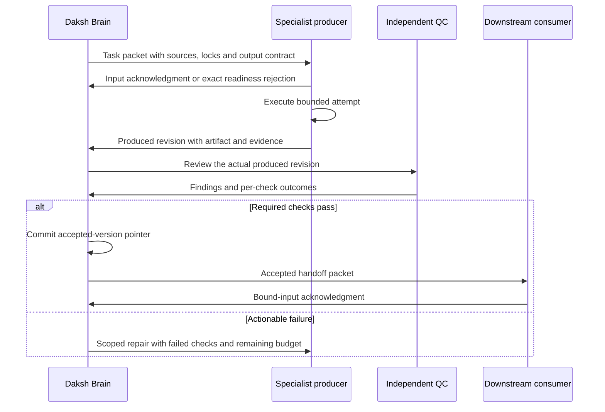
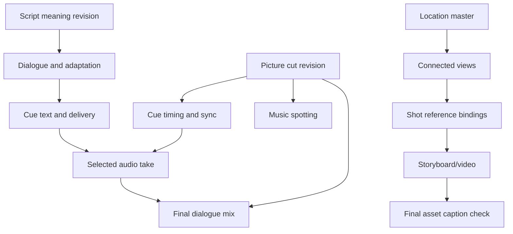
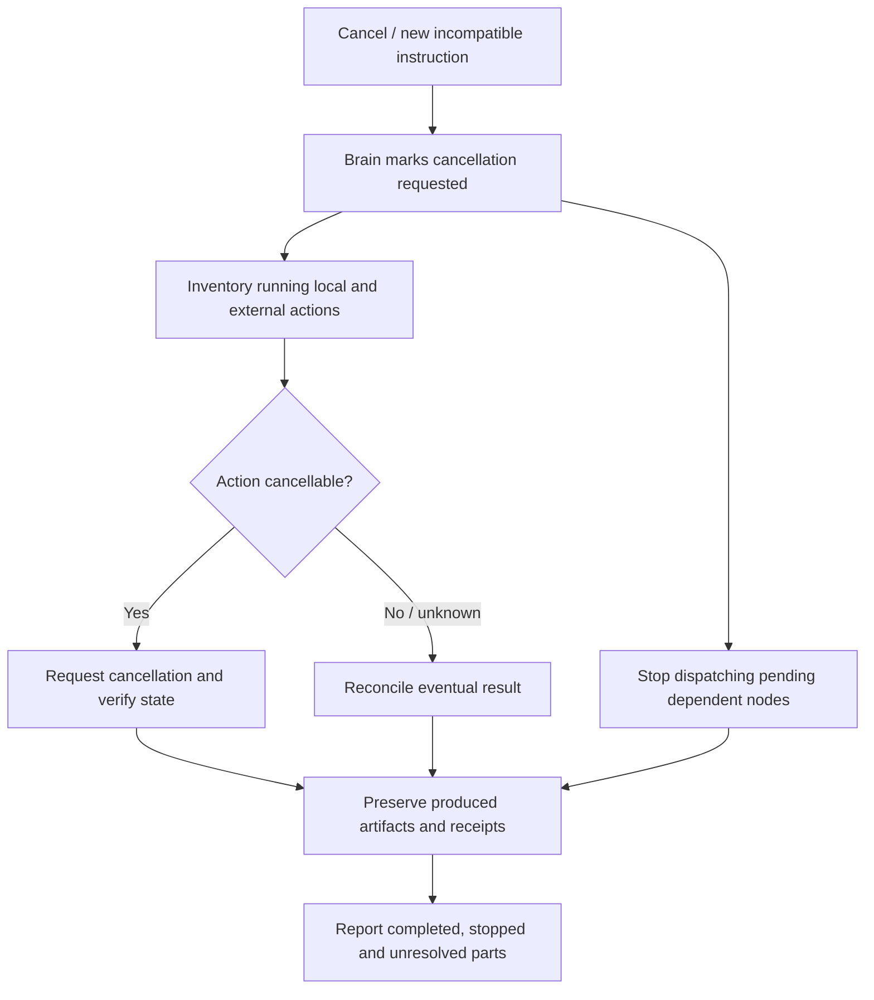

# Handoffs, canon, quality control and recovery

Daksh Brain is the final integration and acceptance owner. Domain specialists own their assigned artifacts; independent reviewers judge evidence against the task contract. A polished handoff cannot substitute for actual execution, and a mechanically valid file cannot prove media quality.

This protocol is the target design for operating the workflows in [WORKFLOWS.md](WORKFLOWS.md). It does not assert that an event bus, database, queue, scheduler, provider adapter or automated QC service has been deployed. The repository's existing skill scripts remain the implementation evidence; any new runtime must implement and test these contracts before claiming to enforce them.

## 1. Ownership and responsibility

| Responsibility | Accountable owner | Delegated role |
|---|---|---|
| Interpret current user objective and action authorization | Daksh Brain | Relevant domain owner assists |
| Select workflow and manage dependencies/budget | Daksh Brain | `operations` or domain coordinator assists |
| Produce one named artifact revision | Assigned specialist | Tool/operator within that node's envelope |
| Maintain shared canon and accepted-version pointers | Daksh Brain | `knowledge` prepares changes |
| Compile exact visual/source bindings | `reference-mapper` under Brain | Location/Director supply domain context |
| Verify actual tool capability and external result state | `capability-operator` under Brain | Domain specialist verifies usable output |
| Review domain content and actual artifact | `independent-qc` or named domain reviewer | Specific visual/language/technical reviewer |
| Validate new behavioral locks and routing | `brain-evals` under Brain | Affected skill owner supplies cases |
| Final integration, requested action and user response | Daksh Brain | Specialists return receipts/evidence |
| Founder/persona/strategy advice | `maniik-advisor` under Brain | Advisory only; no parallel authority chain |

Every artifact has one writer at a time. Reviewers annotate or produce findings; they do not silently overwrite accepted creative work. Brain resolves conflicts and dispatches the selected fix to its owner.

## 2. The handoff packet

A producer sends a **task packet**, not a vague instruction such as “make it cinematic.” Required fields are proportional to the job. A one-line prompt correction needs less metadata than a multilingual picture-locked release, but all packets preserve objective, inputs, allowed change and acceptance.

The implemented design-time JSON contracts live in [task.schema.json](../../architecture/contracts/task.schema.json), [handoff.schema.json](../../architecture/contracts/handoff.schema.json) and [artifact.schema.json](../../architecture/contracts/artifact.schema.json). Use those exact field requirements for machine validation. The richer descriptive packet and YAML illustration here explain the domain information those contracts carry; they are not alternate executable schemas.

| Group | Fields | Why it matters |
|---|---|---|
| Identity | `task_id`, `node_id`, `workflow_id`, `parent_task_id`, `assigned_role` | Prevents outputs from adjacent jobs being mixed |
| Intent | `objective`, `requested_artifact`, `audience`, `scope` | Keeps the specialist solving the user's actual need |
| Provenance | Source URI/path, source type, revision/hash, retrieval time and accessibility | Distinguishes usable input from remembered or historical context |
| Canon | Canon version plus explicit scoped lock IDs | Prevents stale defaults from overriding approved decisions |
| Change envelope | `allowed_changes`, `protected_elements`, excluded actions | Prevents a local repair becoming a redesign |
| Dependencies | Required input artifacts and accepted revisions, readiness conditions | Makes the execution order inspectable |
| References | Reference role, actual accessible file, exact tag and target binding | Distinguishes identity from opening/ending frame or architecture |
| Domain data | Scene/shot ID, language/cue, look/product ID, metric definitions, repo/ref as applicable | Carries the information that makes the artifact correct |
| Output contract | Count, dimensions/ratio, duration, language, native format and destination | Prevents delivering prompts when images/audio/files were requested |
| Action envelope | Authorized operations, recipient/destination, cost/attempt/concurrency caps | Avoids invented permission and unnecessary repeated approval |
| Acceptance | Mechanical checks, semantic checks, actual-artifact review and required human judgment | Defines observable completion |
| Execution | Attempt ID, tool/interface, configuration actually used, external request ID | Supports diagnosis, status lookup and duplicate prevention |
| Result | Artifact paths/links/hashes, state, findings, unresolved dependencies and next owner | Gives the consumer something verifiable |

### Synthetic packet

The following is an illustrative contract, not a new executable schema or a real project record. IDs, file names and tags are synthetic.

```yaml
task_id: example-campaign-01
node_id: hero-prompt
workflow_id: fashion
parent_task_id: example-campaign-01
assigned_role: fashion-campaigner
objective: Produce the approved campaign's hero image prompt.
requested_artifact: standalone_image_prompt
scope:
  project: synthetic-campaign
  asset: hero-01
  language: en
canon_version: example-canon-r3
inputs:
  - artifact_id: model-reference
    revision: r1
    path: examples/source/model-reference.png
    accessibility: must_be_verified_before_execution
    reference_role: facial_identity
  - artifact_id: garment-reference
    revision: r2
    path: examples/source/garment-reference.png
    accessibility: must_be_verified_before_execution
    reference_role: exact_garment
locks:
  - id: garment-r2-design
    scope: asset:hero-01
    rule: Preserve cut, material, color, hardware and visible brand text.
  - id: model-r1-identity
    scope: asset:hero-01
    rule: Preserve supplied facial identity and photorealistic facial detail.
allowed_changes:
  - pose within the approved concept
  - camera distance within the approved framing
protected_elements:
  - garment design
  - model identity
  - approved palette and light family
output:
  count: 1
  format: markdown
  aspect_ratio: "4:5"
action_envelope:
  allowed: [read_sources, author_prompt]
  paid_generation: not_authorized_by_this_example
acceptance:
  - required sources were actually inspected
  - every standalone prompt includes required reference bindings
  - one dominant physical action
  - no invented product facts or image-generation claim
result:
  state: planned
  artifacts: []
  unresolved_dependencies:
    - example source files are illustrative and are not bundled here
```

Do not use placeholder example paths as if they were actual accessible pixels. A real packet must bind to actual input artifacts or state the missing dependency.

## 3. Producer–consumer handshake

1. **Brain dispatches:** identifies owner, current inputs, locks, output and acceptance. A dispatch record proves assignment only.
2. **Consumer validates readiness:** confirms input access and revisions. It acknowledges `accepted_for_execution`, or rejects the packet with the exact missing field/conflict. Rejecting input is different from failing the completed artifact.
3. **Owner executes:** records attempts and outputs. It does not change locked inputs to make the task easier.
4. **Owner returns produced revision:** includes usable artifacts, checks actually run, unresolved dependencies and the precise proposed next owner.
5. **QC reviews:** evaluates the produced revision and records `pass`, `fail`, `not_run` or `not_applicable` per check. It does not count `not_run` as a pass.
6. **Brain integrates:** accepts the result, requests scoped repair or chooses an explicit tradeoff. Only Brain updates authoritative accepted-version pointers.
7. **Downstream consumer binds:** uses that accepted revision and acknowledges its own readiness. It must not silently consume an older file with the same name.



### Useful result states

| State/event | Meaning | Does not mean |
|---|---|---|
| `planned` | Scope and owner recorded | Worker started |
| `running` | Actual execution attempt started | Output exists |
| `produced` | Identifiable artifact exists | Artifact inspected or approved |
| `inspected` | Actual artifact was reviewed | Every criterion passed |
| `validated` | Specified checks passed | User creatively approved it |
| `accepted` | Brain accepted this revision for stated downstream use | Public release permission exists |
| `user_approved` | User approval observed for the stated scope/version | All future changes are approved |
| `scheduled` | Scheduler receipt/state observed | Publication already occurred |
| `published` | Destination publication state observed | Engagement or quality success |
| `persisted` | Write completed and read back | A running process loaded the change |
| `active` | Runtime/scheduler state verified active | It has successfully completed a run |
| `stale` | Dependency/lock changed enough to require review | File should be deleted |

These are semantic distinctions. A future runtime may use different enum names, but must preserve them.

The existing legacy runtime has its own strict states and identifiers. Adapters must map them explicitly instead of writing these conceptual event names into legacy fields. The new design-time DAG templates do not execute this state machine or migrate live task state by themselves.

## 4. Artifact identity and evidence

Each important output gets a stable artifact ID and immutable revisions. Human-readable names can remain friendly; exact identity comes from the manifest, version and content hash where available.

Recommended artifact fields:

- `artifact_id`, `revision`, `kind`, `owner_role`, creation time and producing task/attempt.
- Local path or permitted destination link; content hash for local files; provider asset/request ID when actually returned.
- Parent/source artifact revisions, canon/lock versions and tool/configuration actually used.
- Requested versus observed dimensions, duration, language, count and format.
- Review records, approval evidence and publication/deployment/scheduling receipts where applicable.
- Material missing dependencies, rejected candidate reason and selected/current status.

An expiring provider URL alone is weak long-term identity. Preserve a stable provider ID and an allowed durable artifact location when the task permits. Do not download media merely to bypass display or access restrictions. Keep secrets out of manifests, logs, screenshots and committed examples.

### Evidence ladder

| Claim | Minimum useful evidence |
|---|---|
| “The instructions include this rule” | Exact relevant source path/version or scoped user instruction |
| “The prompt binds this reference” | Final compiled prompt/payload and binding map |
| “The file was generated” | Actual output artifact and generation receipt where applicable |
| “The frame preserves identity/geometry” | Actual reference and output inspected against those criteria |
| “The voice sounds correct” | Actual audio listened to plus reviewer/result |
| “The cue is in sync” | Actual picture/audio pair at the declared timebase reviewed |
| “The tag is exact” | The specific live preview/view was opened and the displayed tag recorded |
| “The API is healthy” | Actual backend/service response and relevant running-process evidence |
| “The change is in the remote repository” | Observed remote ref/commit and changed file content |
| “The timer is active” | Current scheduler state, identity and next occurrence if exposed |
| “The lesson was saved” | Write plus readback of the intended destination/revision |
| “The provider is connected” | Current authenticated capability/account check, not old docs or environment assumptions |

## 5. Canon and lock management

Canon is the current approved interpretation of shared project facts and creative decisions. It is not an agent's private recollection. Brain maintains it through the repository's supported versioned mechanism.

### Lock classes

| Lock | Examples | May change when |
|---|---|---|
| Exact text | Dialogue, spelling, punctuation, ordered speakers, brand copy | Current scoped user authorization permits rewrite |
| Identity | Character/model face, costume/look, voice casting | Approved identity/look/cast revision changes |
| Geography | Master set, doors/stairs, screen direction, camera axis, light direction | Authorized master/shot change and impact review |
| Frame | Crop, camera angle/height, visible inventory, composition, focus | The request explicitly unlocks that variable |
| State | Prop held/placed, open/closed, costume condition, character knowledge | Story beat/current source changes |
| Timing | Picture cut, cue timecodes, overlap, reveal order, music hit | Authorized edit/timing revision |
| Product/brand | Garment cut/fabric/hardware, authentic logos/pack text | Approved product/reference revision |
| Data definition | Units, time period, denominator, metric calculation | Explicit definition change with affected analyses updated |
| Execution | Repo/ref, language set, output format, spend/attempt cap | Current task authorization or budget changes |
| Scope exception | One shot's placement, poster-only visibility, one-language pronunciation | Only within its recorded scope unless user broadens it |

Each lock needs its scope, source, effective version and status. “Approved” requires approval evidence; a proposal remains a proposal. Prefer the precise source instruction over a generalized paraphrase when small wording differences affect execution.

### Canon update transaction

1. Brain identifies the requested change and its actual scope.
2. The responsible owner proposes a new revision and affected dependency list.
3. Resolve conflicts against the latest user instruction, current approved source and applicable overlays.
4. Persist through the supported writer; use expected revision when required.
5. Mark affected outputs stale or needing review, rather than overwriting history.
6. Re-dispatch only necessary work, run relevant checks and update accepted pointers.
7. Record what changed, why and which outputs remain valid.

Existing `brain/DAKSH_BRAIN.json` is edited through `skills/daksh/scripts/brain.py` with `--expected-revision`. Direct replacement would bypass the existing concurrency contract. Preserved snapshot folders remain historical and are not rewritten to look current.

## 6. Dependency invalidation

Invalidation follows **actual dependency edges**, not vague association. Brain tracks which fields each artifact consumes. A changed field invalidates dependent checks/outputs only when it could affect them.



| Changed source | Review/invalidate | Usually keep if unchanged |
|---|---|---|
| One cue's exact spoken text | That cue's delivery/render request, selected take, transcript/native/acting review and dependent mix | Unrelated cues/languages with no changed meaning/source |
| One language adaptation | That language's affected cues, pronunciation/takes and release rows | Other approved language versions |
| Picture cut/timebase | Cue boundaries, sync review, affected overlap/edit points, music spotting and final mix | Source dialogue wording/cast if still valid |
| Voice identity/config | Affected voice's requests/takes and voice/acting checks | Location/still imagery and unrelated cast |
| Location permanent master geometry | Connected views, derived camera bindings and shots using changed geometry | Unaffected neutral-grey prop turnarounds |
| Prop state in one shot | That shot's inventory/prompt/render and adjacent continuity where consumed | Permanent prop design and unrelated scenes |
| Crop/resize only | Pixel-coordinate mapping, crop checks, visible inventory and any dependent geometry overlay | World layout that was not changed |
| Garment/look reference | Affected campaign prompts/assets and product-fidelity checks | Copy facts unrelated to appearance |
| Final hero image | Its crop/alt-text/thumbnail/caption factual check | Other accepted images with independent source |
| Caption wording | Its copy/length/public-field review and scheduled payload if present | Approved source image/audio |
| Metric definition/data refresh | Derived calculations, chart labels, period comparisons and decision claims | Unrelated static brand/copy assets |
| Code contract/API schema | Consuming callers, relevant tests/docs and integrations | Unrelated modules confirmed outside impact |
| Provider limit/interface | Request compiler/validation and execution readiness | Approved creative source/intent |

When impact is uncertain, mark the relevant branch `needs_review` with the exact uncertainty. Do not label every output invalid simply because one shared project file changed; do not label everything safe without checking consumed fields.

## 7. Quality control as evidence-based gates

QC applies several different lenses. They cannot replace one another.

| Layer | What it checks | What it cannot establish |
|---|---|---|
| Mechanical | Schema, files, counts, literal tags/text, character budget, dimensions, format, link targets | Acting, likeness, geography, musicality or truth of claims |
| Source/provenance | Correct accessible source, revision, approved state and binding | Quality of a generated output not inspected |
| Semantic/domain | Meaning, story logic, instruction fit, cultural/linguistic plausibility, mathematical definition | Native performance or lip sync without actual media |
| Actual artifact | Pixels, motion, audio, renders, UI interaction, service response | Broader authorization or unseen production states |
| Integration | Cross-shot/asset/language consistency and release completeness | Missing domain checks inside individual artifacts |
| Human/domain signoff | Native language, final creative/client approval or required specialist decision | Automatic permission for future revisions |

### Reviewer packet

Give QC the user's objective, exact protected inputs, allowed changes, current canon, actual output revision and relevant source artifacts. Supply the criteria and evidence; avoid telling an independent reviewer that the output is “already correct.”

For substantial work, a fresh reviewer should be separate from the producing context when available. If no independent worker ran, label the result **same-context self-review**. Do not invent an independent team or signoff.

### Finding format

Each actionable finding contains:

1. Criterion and severity.
2. Exact affected artifact/revision and location/timecode/field where relevant.
3. Observed issue and supporting evidence.
4. User/production consequence.
5. Smallest necessary repair and expected recheck.
6. Dependencies invalidated by that repair.

Example: “Major — hero-r2 adds an unrequested belt absent from garment-reference-r1. This changes the protected product design. Remove only the added belt and repeat garment-fidelity/pose-contact review.” This is actionable; “make it more premium” is not a QC failure.

### Severity and acceptance decisions

| Severity | Meaning | Decision |
|---|---|---|
| Blocker | Wrong/missing target, inaccessible required source, unauthorized action, violated hard lock, unusable artifact or false completion claim | Do not accept the affected deliverable |
| Major | Core objective/continuity/meaning/function materially fails | Repair and recheck before acceptance |
| Minor | Usable result with a localized quality issue outside hard locks | Repair when practical; Brain may explicitly disclose/accept the tradeoff |
| Suggestion | Optional creative/technical improvement | Does not justify scope expansion by itself |

Hard locks cannot be “averaged out” by a high aesthetic score. A beautiful frame with wrong face/garment/dialogue fails its required criterion. Score thresholds are domain-specific; use the Socials source rubric only where it applies.

## 8. Domain acceptance checklists

### Film and storyboard

- Correct screenplay/scene/shot source, supplied IDs and requested coverage.
- Actual frame-role bindings; exact visible/partial/reflected owners and offscreen audio separated.
- No leaked unseen cast/props or mismatched location orientation, in tags **or prose**.
- Strict frame/camera/crop/light locks honored; unlocked choices serve the story.
- Still is one possible instant; action order, screen direction, axis, eyelines and prop state remain consistent.
- Exact video dialogue is last, with nothing after the final line; current scoped delivery-tag rule applied.
- Actual reference/output inspected for identity, anatomy, material/contact, geometry and reveal timing where media exists.
- Sequence/video reviewed for temporal continuity and sync where claimed. Text validation alone is labelled as text validation.

### Locations and prop libraries

- Correct permanent master and approved state reused.
- Views preserve landmarks, door/stair positions, world light, scale and connectors.
- Object front and world direction distinguished; reverse/side views are not mirrored substitutes.
- Requested prop views are complete, full object visible and consistent; studio background is not a scene location.
- Exact-tag inventory opens every required preview/view and records evidence plus scene mapping.
- Panorama/geometry/walkability claims match actual inspection/testing level.
- Region-specific architecture/material/utility details serve the stated setting without breaking continuity.

### Dubbing

- Canonical words/punctuation/order remain protected; tagged text/payload separated.
- Correct speaker, language variety, picture revision, cue boundaries and intentional overlaps.
- Current endpoint/voice/config availability verified before execution.
- Actual takes available and selected file/hash recorded.
- Native-language/meaning, acting, timing/lip-sync and technical audio checks recorded separately.
- Failed cue repair stays within the existing maximum two new candidates per cycle unless project approval differs.
- Local repair invalidates only actual dependent cues/takes/mix; release metadata does not masquerade as listening approval.

### Music

- Correct artifact/mode: instrumental, lyrics, score, SFX and analysis remain distinct.
- Approved hook/lyrics, emotional opening/ending, requested instruments and exclusions preserved.
- Actual pasteable prompt counted against the applicable user/editorial field budget.
- Provider controls verified for the actual interface where execution depends on them.
- Actual audio listened to for composition, intelligibility, vocal exclusions, timing and mix where claimed.
- Text-only musical direction never reported as a completed track.

### Fashion

- Requested count, hero/supporting purposes and standalone prompt completeness.
- Same supplied model identity; exact garment design, fabric, hardware and authentic requested text/branding.
- Consistent palette/light/medium/hair/makeup across the intended visual system.
- Distinct useful shot purposes with physically plausible pose/contact.
- Crop/frame constraints retained; no extra cast, set dressing or outfit introduced against locks.
- Actual outputs inspected before claiming face/product/text fidelity.

### Socials

- Correct caption command, requested platforms/count/language and current five-group six-platform default.
- Shared IG/FB copy unless explicitly split; Pinterest Title and Description clearly separated.
- Factual claims, team credit, confidentiality and source/visual alignment.
- Current relevant platform limits, including weighted X count, where material.
- Every public field and attachment reviewed, not only caption body.
- Actual researcher/writer/evaluator separation labelled honestly; applicable source rubric and revision cap respected.
- Draft/approval/schedule/publication/metrics states remain distinct.

### Engineering

- Correct repository/ref, preserved unrelated work and requested behavior.
- Applicable instructions and current relevant API/interface verified.
- Meaningful targeted checks appropriate to risk; unrun checks stated.
- Integration configuration/current service state checked before connected/healthy claims.
- Diff and actual authorized remote push/deployment state verified.
- No credentials, raw private source dumps or unrelated permission changes introduced.

### Research, business, documents and data

- The actual question/decision and audience answered; strongest recommendation explicit.
- Primary/current sources when needed; dates, assumptions and inference distinguished.
- Internal/private identifiers kept out of public research.
- Calculations reproducible; metric definitions, periods, units and denominators clear.
- Actual requested native artifact produced and rendered/functionally reviewed.
- No invented commercial results, professional signoff, approvals or account connections.

### Operations and learning

- Current account/scheduler state verified; no duplicate or unauthorized resumed jobs.
- Correct timezone, recurrence, target, stop condition and notification intent.
- Actual action receipts and post-change state observed.
- Durable learning specifically authorized, scoped and written through its required mechanism.
- Readback and required eval gates complete before a saved/validated claim.
- Missing/paused source or skill remains explicit; documentation does not revive it.

## 9. Failure classification and bounded recovery

Brain classifies the failure before deciding whether another attempt is useful.

| Failure class | First response | Retry rule | Escalation |
|---|---|---|---|
| Missing/incorrect input | Retrieve correct source or reject readiness with exact missing item | Do not regenerate against knowingly wrong inputs | Ask only for essential unavailable material |
| Capability unavailable/auth missing | Verify live capability and supported fallback | Do independent preparation; do not repeatedly call a known unavailable service | State specific capability/account need |
| Transient read failure | Retry boundedly with relevant backoff/status information | Repeated unchanged failures end the retry loop | Report failure and preserve completed work |
| Rate limit | Respect returned retry guidance and remaining budget/deadline | Do not launch duplicate workers to evade the limit | Brain replans schedule/concurrency |
| Invalid request/schema | Inspect actual interface and repair the request once understood | No blind retry of the same invalid payload | Request implementation fix if unsupported |
| Ambiguous paid action | Look up existing request/job/result first | Resubmit only after nonexecution/failure or safe idempotency is established | Brain resolves state/cost uncertainty |
| Content/quality failure | Diagnose exact failed criterion against source/artifact | Change the failed variable; use domain/project repair cap | Expose unresolved issue when cap reached |
| Canon/version conflict | Pause dependent nodes and reconcile revisions | Retry with explicitly selected current inputs | Brain decides scope; user only if source conflict cannot be inferred |
| Concurrent write conflict | Re-read current revision and apply nonconflicting patch | Use expected revision/compare-and-swap where supported | Brain serializes conflicting writers |
| Test/validation failure | Determine whether caused by change, environment or stale expectation | Fix cause, rerun affected checks | Do not report an unrun or failed check as passed |
| External mutation partial success | Reconcile exact destination state and receipt | Retry only missing safe step | Do not duplicate sends/posts/payments |
| Hook/plugin loop | Inspect the reported missing file/plugin state using available tools | Do not keep replying with the same unverified blocked claim | Repair only within scope or report exact safe recovery step |

Attempt count includes actual new provider submissions, not harmless local analysis or a request-status query. Paid generation attempt budgets and credit budgets are separate; respect both. Do not increase provider tier, resolution, call count or production spend as an invisible “quality fix.”

### Suggested local retry envelope

The default design is conservative: one initial attempt, a diagnosed repair when reasonable, and stop/replan when repeated unchanged failure makes another attempt uninformative. Domain instructions and the user's explicit budget override this suggestion. Dubbing retains its explicit **at most two new repair candidates per cycle**; the applicable Socials review workflow retains its two revision-cycle cap. No universal retry count overrides those rules.

## 10. External actions, idempotency and receipts

A task may already authorize an external action. Brain should finish authorized necessary work without asking “proceed?” again. Equally, generic documentation, planning or learning permission does not imply sending messages, spending credits, training voices, publishing or resuming automations.

For an authorized action:

1. Prepare the exact reviewable payload/artifact first.
2. Bind destination/account/ref/recipient and current artifact revision.
3. Check existing action state if an earlier attempt may have partially executed.
4. Use a stable operation fingerprint/idempotency mechanism when the service supports it.
5. Perform the action once.
6. Record returned receipt and verify the destination state.
7. Reconcile uncertainty before retrying.

An operation fingerprint should include the logical operation, target and payload revision. A retry of the same intended action reuses its identity; an authorized materially new action receives a new identity. Do not claim idempotency is enforced when the provider offers no such support; use status lookup and explicit reconciliation instead.

For Git delivery, record repository, branch, pre-action base/ref, resulting commit and observed remote ref. A local commit is not a push; an open PR is not a merged main branch. For service restarts, report web and API state separately when they are separate services.

## 11. Cancellation, interruption and partial execution



- New user input normally steers the ongoing task. Replan the affected scope while preserving the original objective unless the user cancels or replaces it.
- On explicit cancellation, stop pending dispatch and request cancellation of eligible running work. Do not assume an interrupted local/tool call never executed.
- Keep completed artifacts and audit receipts. Delete or roll back only when authorized and safe; cancellation is not an instruction to destroy user work.
- A provider cancellation request is not confirmed cancellation, refund or deletion. State observed status.
- If a write/push/post may have completed before interruption, query the actual target before attempting it again.
- Resume from accepted checkpoints and current source state. Do not rerun all paid jobs merely because a chat was restarted or compacted.

## 12. Checkpoint and recovery bundle

A substantial task keeps enough compact state for another session/worker to continue without raw conversation reconstruction:

| Record | Required contents |
|---|---|
| Current objective | User intent, latest steering, requested deliverable and completion criteria |
| Active DAG | Node owners, dependencies, states and accepted revisions |
| Canon pointer | Current approved versions and scoped lock references |
| Artifact manifest | Paths/IDs/hashes, selected candidates, reviews and destination receipts |
| Action ledger | Authorized envelope, attempted external actions, request IDs and ambiguous results |
| Budget ledger | Used/remaining approved attempts/credits/time where observable |
| Open issues | Exact missing input, failed criterion, blocker and independent work still possible |
| Next safe step | Concrete action that does not duplicate uncertain side effects |

These are proposed runtime records. Store them in an appropriate private task workspace when implemented; do not commit live credentials or raw private chat/production records into examples. Repository architecture docs should contain generalized operating knowledge, not an account export.

## 13. Logging, privacy and observability

Log enough to explain a result without logging everything. Useful events include `task_received`, `source_bound`, `node_ready`, `attempt_started`, `external_request_recorded`, `artifact_produced`, `qc_completed`, `revision_accepted`, `dependency_invalidated`, `action_verified` and `task_completed`.

Each event should carry task/node/attempt identity, time, role, relevant artifact revision, outcome and a short reason. Keep sensitive content in scoped source storage and reference it by stable IDs where possible. Redact tokens, passwords, authorization headers, signed URLs and account secrets from tool outputs and commits. A private repository is not a credential store.

Useful measures are actual task completion, first-pass acceptance, repair causes, stale-input incidents, duplicate-action avoidance, blocked time and observed spend. These are proposed measurements, not claimed existing metrics. Avoid optimizing raw agent count or generated-file count as if either measured usefulness.

## 14. Final delivery packet

Brain's final delivery is concise even when the internal work is extensive:

1. Lead with what was completed and where the usable output is.
2. State what changed and why where it matters.
3. Summarize checks that actually ran; distinguish text checks from media/service validation.
4. Include actual remote/action receipt when the task requested push, publication, schedule or deployment.
5. State only material unresolved dependencies/limitations and their impact.
6. Do not claim hidden agents, inaccessible historical sources, unavailable media or unconnected services were recovered or activated.

The user should not need to inspect internal agent traffic to understand the result. A complete response remains honest about the difference between an architecture, source package, implemented runtime and live production execution.
