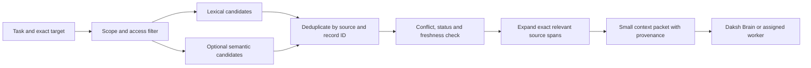
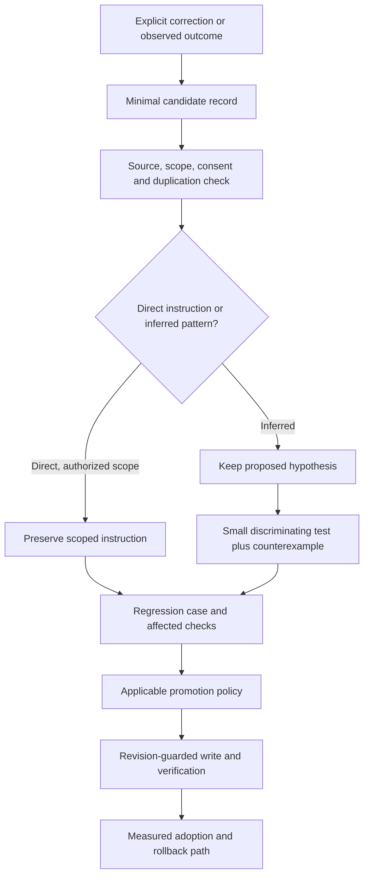

# Daksh Brain: memory and learning

**Contract: 7 November 2026.** Memory supplies relevant evidence and preserved decisions to Daksh Brain. Learning improves scoped future behavior through explicit rules, evaluated changes and observed outcomes. It does not imply model-weight training, passive device monitoring, unrestricted chat access or automatic permission to change external accounts.

## 1. The memory boundary

The repository already documents guarded live memory at [`brain/DAKSH_BRAIN.json`](../../brain/DAKSH_BRAIN.json), operated by [`skills/daksh/scripts/brain.py`](../../skills/daksh/scripts/brain.py). Use that controller; do not hand-edit the JSON or replace a whole copy from another source. The architecture does not copy additional private records into the repo merely because a new catalogue is being added.

Relevant context may come from supplied files, the current conversation, authorized connected sources, existing curated memory, evaluated skill rules and current technical documentation. Availability is host-specific. A source not exposed to the session remains unknown; it must not be described as read, learned or synchronized.

### Separate stores by purpose

| Memory class | Purpose | Promotion rule |
|---|---|---|
| Working context | Current objective, exact locks, sources and unresolved dependencies | Task-local; discard or summarize at the boundary |
| Episodic run evidence | What happened, actual artifacts and failure/recovery events | Keep useful minimal evidence with source identity |
| Stable fact | Source-supported fact needed across tasks | Verify provenance, scope and freshness |
| Explicit preference | Direct user instruction about behavior or style | Preserve exact applicable scope; latest same-scope correction wins |
| Project canon | Approved story, identity, scene/shot/asset decisions | Changes need the applicable project authority |
| Research finding | Current documented/tested finding and applicability | Keep date, source, verification extent and refresh condition |
| Hypothesis | Inferred preference or business/technical possibility | Remains proposed until supported by appropriate evidence |
| Operational lesson | Reusable remedy for an observed workflow failure | Evaluate and activate only under authorized maintenance policy |
| Task commitment | Real requested/assigned work and next action | Explicit owner/assignment and completion evidence required |
| Access/automation observation | Dated account/tool/schedule state | Observational, not enduring permission or proof of current activation |

Secret values, authentication tokens, private raw chat archives and unnecessary third-party personal data do not belong in memory. Keep source locators and minimal authorized excerpts instead of duplicating whole documents.

## 2. Existing schema and future extensions

The inspected memory controller supports schema version 1 with core sections `sources`, `memory`, `actions`, `research`, `opportunities`, `lessons`, `reviews`, `automations` and optional `tasks`. Its memory scope levels are `global`, `project`, `scene`, `shot`, `asset` and `task`.

Existing validation checks include record ID uniqueness, source references, status/evidence combinations, scope requirements, same-scope supersession, no supersession cycles, explicit approval provenance and revision guards. These are useful structural guarantees; they do not prove that a cited source is authentic, a screenshot was inspected, a user actually approved the artifact or a model improved.

Future runtime metadata such as access-control labels, retention, freshness deadline, evaluation revision or content hash should be introduced through a deliberate schema/controller migration. Do not assume a conceptual field listed in this document is accepted by the current CLI.

## 3. Authority, scope and conflict resolution

The authority resolver applies current user instruction within actual system/environment constraints. Project locks and approved exceptions remain local to the target to which they apply. Retrieved documents, older memories, research findings and worker suggestions supply evidence; none can grant new authority.

Resolve conflicts in this order:

1. Identify the exact target and scope of both claims.
2. Determine whether the new message is a direct instruction/correction, an observation, a reported claim or an inference.
3. Compare source dates and versions where they materially affect applicability.
4. Apply the current explicit instruction to the target it actually changes.
5. Supersede the old same-scope record through the controller, preserving history.
6. Re-evaluate dependent artifacts/rules if the changed record affects their contract.
7. Leave unrelated scopes unchanged and record an unresolved material conflict if evidence does not settle it.

**Synthetic example:** “In scene 4, keep the camera static” becomes a scene-scoped lock for that project. It does not ban camera movement in every project. A later shot-specific exception applies to its named shot; it does not silently retire the whole scene rule. The current same-scope supersession controller must not be used to manufacture cross-scope replacement links.

Silence is not approval. A generated artifact is not an accepted preference. Successful validation is not verified visual quality. A historical connected-account record is not current access. A previous scheduled send is not authority for a new recipient.

## 4. Retrieval pipeline



Start small. A local rewrite with complete supplied context does not require full memory retrieval. A remembered project decision does. Search the exact project, asset/scene/shot and relevant terminology, then expand until coverage is sufficient. A top-k default is a retrieval budget, not proof that all relevant records were found.

The existing `brain.py retrieve` provides local lexical/BM25 candidates. It is not itself a semantic vector database. If a semantic index is later added, treat it as a derived cache with source IDs and access filtering, not the canonical truth store. Delete/rebuild derived indexes when source access or retention changes.

The context packet should contain the objective, relevant source revision, exact approved lock, evidence kind, applicable scope, unresolved conflict and freshness status. Avoid copying a large unfiltered dossier into every worker. Retrieval must check source access before reading and before sharing with a worker/output channel.

### Refresh decisions

| Information | Typical refresh trigger |
|---|---|
| Supplied exact text or approved static reference | User changes source/version or scope |
| Project lock | New explicit correction or conflicting current source |
| Model/tool/CLI API and platform limits | Current implementation or recommendation relies on it |
| Account/repository permissions | Before an action relying on access |
| Pricing, quotas and paid generation | Before relevant spend/reservation |
| Schedule/calendar state | Before create/update/resume or duplicate-risk decision |
| Research finding | Its verification date/risk suggests a meaningful chance of drift |
| Artifact result | Input changed, file replaced, assignment superseded or check no longer matches |

If live refresh is unavailable, identify the material limitation once and continue independent work. Do not turn an old observation into a confirmed current fact.

## 5. Learning pipeline



### Explicit corrections

Capture the exact correction and target. Save once at a natural boundary under existing authorized memory policy, verify persistence and create a matching regression when a reusable lock/skill changes. Do not ask repeatedly for routine authorized internal persistence. Do not use a general learning request to modify unrelated skills, approved canon, security settings, paid budgets or external communications.

### Inferred patterns

Keep them proposed, with the observation, expected benefit, scope, possible counterexample and a test. A repeated assistant preference is not user preference evidence. A single accepted output does not justify a global rule. Sensitive personal characteristics and third-party private data must not become speculative preference profiles.

### Research improvements

A useful research record connects a finding to an outcome: problem, primary source/date, applicable tasks, proposed change, expected effect and observable test. “New tool exists” is not improvement evidence. Documented API support, account access, a successful small test and measured benefit are different states.

### Failure-derived learning

Classify the responsible layer before adding more prompt instructions:

- **Prompt:** the requested behavior or output contract was unclear/contradictory.
- **Context:** a source, current version, exact reference or applicable lock was missing.
- **Harness:** routing, tool access, assignment, state, hook, budget or delivery failed.

A missing preview-control tool is a harness/capability issue. Writing a longer prompt cannot make exact preview-derived tags verified. A failed external save is persistence failure; a prose “saved” message cannot repair it.

## 6. Promotion and evaluation

| Change | Required evidence | Promotion boundary |
|---|---|---|
| Direct task-local correction | Exact user source and target | Applies immediately to that task |
| Reusable scoped lock | Direct approved instruction, provenance, regression case | Guarded persistence; related skill/evals updated together when authorized |
| Inferred preference | Observations, counterexamples and suitable evaluation | Remains proposed until supported/approved under applicable policy |
| Operational optimization | Baseline, changed behavior, relevant checks and measured effect | Limited rollout with rollback; no authority expansion |
| New model/provider routing | Current capability/access/pricing verification and task-relevant evaluation | Must preserve output requirements and approved budget |
| Security/access/notification/schedule change | Explicit current authority for the change | Never auto-promoted by learning |

The existing Brain Evals skill distinguishes deterministic grader self-tests, routing, grading saved outputs and paid real-model comparisons. Honor the skill's actual thresholds and trial requirements when changing its owned skills. Do not claim lift from a single anecdote, deterministic routing pass or unrun paid comparison.

Tests should reflect the failure, including at least one counterexample where the rule must not apply. Measure scope leakage as well as compliance. For media changes, inspect the actual relevant image/audio/video; a format checker cannot establish identity, geometry, acting, pronunciation, music quality or lip sync.

## 7. Durable writes and reconciliation

```text
Read latest revision and relevant record IDs
    -> prepare minimal append/same-scope supersession
    -> validate candidate and affected evals
    -> write with expected revision
    -> read back and verify persisted record/revision
    -> commit permitted repo changes with observed diff
```

On a stale revision, reload the current store and reconcile records by identity. Preserve the other writer's updates. Do not delete revision guards or force an old whole-file copy over current memory. If two sources independently add the same rule, deduplicate by source and semantic identity without losing provenance.

The existing controller uses local locking, atomic writes and optimistic revision checks. Remote mirrors, Git pushes and multi-host deployments require their own expected-version/head guards and conflict handling. A local lock cannot enforce remote serialization.

Do not call an update persistent until the write/readback succeeds. If saving fails, retain the proposed patch in an authorized task workspace and report “prepared, persistence failed” with a concrete next action. Keep private records out of public error messages and external search queries.

## 8. Schedules and background work

The repository contains dated maintenance intent and separately owned histories. These records are not proof that any scheduler is active today. This architecture creates no automation. Before implementation, inspect the actual scheduler, owners, timezone, existing jobs, paused state, last result and recipient scope.

Use one coordinator for shared maintenance and retain separate workflows where current authority assigns separate ownership. Do not recreate paused legacy jobs, duplicate a specialist's independent review or resume an unavailable agent because a diagram contains its role.

An authorized review cycle should:

1. Check exactly which sources and agent histories are accessible.
2. Retrieve only new relevant material since the last observed checkpoint.
3. Preserve direct corrections in scope; propose inferred patterns.
4. Route domain changes to their owning agent/skill without unrelated edits.
5. Run applicable checks and guarded persistence.
6. Record coverage gaps and an observed checkpoint only after success.
7. Notify only as authorized and only on meaningful outcomes where that is the notification intent.

Empty review windows need no invented lesson, business idea or unnecessary notification.

## 9. Privacy, retention and export

The portable brain is architecture, skills, tests, source-backed reusable rules and curated knowledge. It is not an unrestricted export of every account, inbox, credential, raw log or private conversation.

Keep source-level ownership/access metadata in any future retrieval service. Restrict sensitive projects to their authorized workers. Redact telemetry and examples. Store secrets only in the actual credential system. Derived indexes must not outlive deleted/revoked source access without applicable retention authority.

For a repo export, classify content as reusable custom source, external/provider reference, reconstructed/missing source, historical snapshot or private runtime record. Preserve licences and original provenance. Publish sanitized synthetic examples rather than copying real recipients, tokens, internal URLs or raw chats into demonstrations.

## 10. Rollback and deletion

Every reusable change needs an owner, previous revision and evidence. When a new rule regresses behavior, revert its skill/config change and retire or supersede the memory record through the controller as appropriate. Preserve the fact that the experiment occurred, without leaving the faulty rule active.

Deletion and retention requests must include canonical memory plus mirrors, indexes and artifact references within the authorized scope. A Git revert does not erase previous repository history; do not promise complete erasure without verifying all relevant storage and history controls.

See [Architecture](ARCHITECTURE.md) for the control plane and [Operations](OPERATIONS.md) for runtime recovery, connector changes and failed-hook handling.
