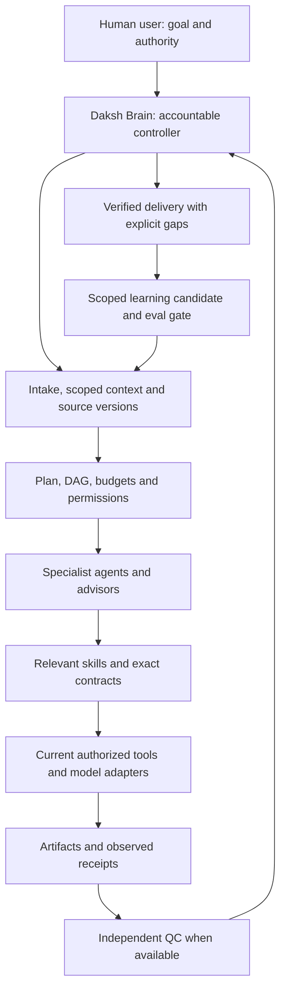

# Daksh Brain: complete system map

**Architecture edition: 7 November 2026.** Daksh Brain is the top AI controller. The human user sets objectives, scope and authority. All specialist agents, the maniik founder/style advisor, skills and tools operate under that controller.

This edition connects the existing creative-agent repository to a broader, inspectable operating design. It includes working offline validation and planning utilities. It does **not** claim an autonomous fleet, a deployed server, connected accounts, running schedules or generated media.



## Read in this order

| Need | Entry |
|---|---|
| AI-film production, viral studio and Mann editing | [AI-film integration](AI_FILM_INTEGRATION.md) |
| Overall hierarchy, components, runtime boundaries and roadmap | [Architecture](ARCHITECTURE.md) |
| Exact task flows, modes and recovery behavior | [Workflows](WORKFLOWS.md) |
| Source, assignment, artifact and QC handoffs | [Handoffs and QC](HANDOFFS_AND_QC.md) |
| All discovered skills, tool families and activation limits | [Skills and tools](SKILLS_AND_TOOLS.md), [complete skill table](../../catalog/SKILLS.md) |
| What is learned, how provenance works, conflict and promotion rules | [Memory and learning](MEMORY_AND_LEARNING.md) |
| Reproducible local commands, operations and failure runbooks | [Operations](OPERATIONS.md) |
| Reusable lessons and working preferences that shape the system | [Learned operating rules](LEARNED_OPERATING_RULES.md) |
| Source dates, licensing, omissions and migration decisions | [Coverage and provenance](COVERAGE_AND_PROVENANCE.md) |
| Check results for this edition | [Validation report](VALIDATION_REPORT.md) |

## Machine-readable source of truth

| File | Purpose |
|---|---|
| [architecture/agents.json](../../architecture/agents.json) | 28 roles, one Daksh Brain parent, inputs, ownership, locks, outputs, checks and source skills |
| [agents/contracts/](../../agents/contracts/) | One readable execution contract per role |
| [architecture/workflows.json](../../architecture/workflows.json) | 30 design-time dependency graphs, required inputs and acceptance checks |
| [architecture/policies.json](../../architecture/policies.json) | Authority, budgets, capabilities, memory, delivery and safety boundaries |
| [architecture/contracts/](../../architecture/contracts/) | Four JSON Schema contracts: task, handoff, artifact, memory candidate |
| [architecture/examples/](../../architecture/examples/) | Synthetic validated examples without private project records |
| [architecture/legacy-role-map.json](../../architecture/legacy-role-map.json) | Existing role IDs mapped to the new canonical IDs |
| [catalog/skills.json](../../catalog/skills.json) | Inventory with source provenance, domain ownership and availability dimensions |
| [catalog/tools.json](../../catalog/tools.json) | Advertised tool capability inventory, not active-account guarantees |
| [tools/daksh_architecture.py](../../tools/daksh_architecture.py) | Offline structural/schema validator and deterministic plan preview |

## Agent families

- **Control:** Daksh Brain; maniik Founder/Style Advisor; Action/Style Learning; Tools/Connector Operator; Independent QC; Brain Evals.
- **Creative production:** Writer; Native Director; Reference Mapper; Location; Music; Suno helper; Dubbing; Fashion; Socials; Design.
- **Research and decisions:** Research/Intelligence; Business Strategy; Data/Analytics; Knowledge; Finance; Legal.
- **Delivery and work:** Engineering; Documents; Operations; Sales; Support; People.

These are role definitions. Daksh Brain instantiates only useful roles for the current task. A five-line correction does not require all 28 agents.

## Try the offline specification

```bash
python3 -m pip install 'jsonschema>=4.20,<5' pytest
python3 tools/daksh_architecture.py validate
python3 tools/daksh_architecture.py plan screenplay-to-film \
  --inputs architecture/examples/film-inputs.json --max-parallel 3
python3 -m pytest -q -p no:cacheprovider tests/
```

The planner prints required missing inputs or topological task batches. It launches **zero** workers and makes **zero** provider calls. It does not write to the live brain or grant permissions. The existing task ledger remains [skills/daksh/scripts/orchestrator.py](../../skills/daksh/scripts/orchestrator.py); its strict shape must be respected separately.

## Definition of done for a real run

The user's requested artifact exists, source/approval versions are current, required specialist and QC checks are satisfied, actual delivery or save is observed, and unresolved limits are stated. A document, JSON plan, tool dispatch, paid request or successful API status alone cannot substitute for that outcome.
