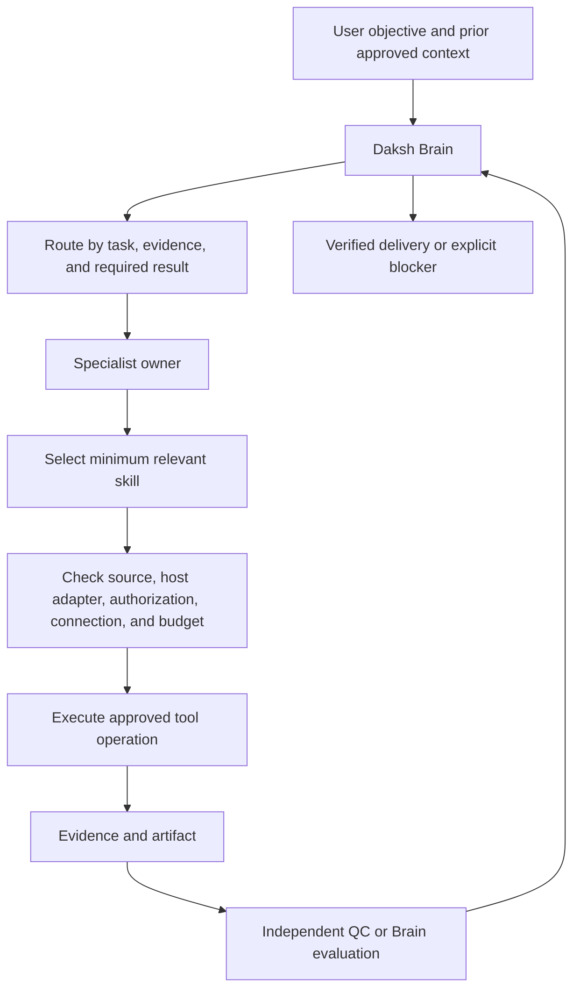

# Skills and tools under Daksh Brain

Daksh Brain owns the plan, routing, context, dependencies, budgets, final review, and delivery. Specialists own scoped work. A skill supplies a repeatable method; a tool performs an operation through a host or connected service. Neither replaces the Brain's responsibility for task authority and result verification.

The complete machine inventories are [skills](../../catalog/skills.json) and [tools](../../catalog/tools.json). Their readable indexes are [all skill sources](../../catalog/SKILLS.md) and [all tool capabilities](../../catalog/TOOLS.md). Use those inventories for exact names and counts; this document defines how the Brain should use them.

## Skill composition

Skill selection follows the actual objective. It should not trigger every skill that shares a keyword. A complete film package might need writer, director, reference mapping, location, music, and dubbing; an exact prompt correction may need only its current owner and a focused QC check.

## Ownership model

| Capability family | Primary owner | Supporting owner or check |
| --- | --- | --- |
| Objective, routing, dependencies, handoffs, and recovery | `daksh-brain` | `brain-evals`, `independent-qc` |
| Founder strategy and business decisions | `business-strategy` | `research-intelligence`, `data-analytics` |
| Evidence, external references, and source verification | `research-intelligence` | `knowledge`, relevant specialist |
| Story, dialogue, screenplay, copy, and language adaptation | `writer` | `native-director`, `independent-qc` |
| Film direction, shot design, reference continuity | `native-director` | `action-style`, `reference-mapper` |
| Locations, geography, materials, and connected views | `location-director` | `reference-mapper`, `independent-qc` |
| Music, motifs, lyrics, scene score, and instrumental prompts | `music-director` | `suno-helper`, `writer` |
| Voice, pronunciation, casting, emotion, dubbing, and regional delivery | `dubbing-director` | `writer`, `independent-qc` |
| Fashion campaigns and product/model continuity | `fashion-campaigner` | `design`, `reference-mapper` |
| Social research, platform writing, calendars, and performance | `socials` | `research-intelligence`, `data-analytics` |
| Software, cloud, CLI, SDK, deployment, and integration implementation | `engineering` | `independent-qc`, `capability-operator` |
| Visual design, image editing, accessibility, and interface design | `design` | `native-director`, `independent-qc` |
| Data questions, metrics, SQL, statistics, and dashboards | `data-analytics` | `business-strategy`, `independent-qc` |
| Documents, spreadsheets, presentations, and exportable reports | `documents` | `design`, `independent-qc` |
| Planning, coordination, status, capacity, and recurring work | `operations` | `maniik-advisor`, `daksh-brain` |
| Knowledge retrieval, memory provenance, and source organization | `knowledge` | `research-intelligence` |
| Prospecting and account intelligence | `sales` | `research-intelligence` |
| Support, finance, legal, and people workflows | `support`, `finance`, `legal`, `people` | Domain evidence and relevant QC |
| Connector discovery, host execution, and capability health | `capability-operator` | `engineering`, `daksh-brain` |

The inventory assigns every source one primary owner and records whether that assignment came from a curated skill mapping, package default, or name heuristic. Package and heuristic mappings are recommendations; the Brain must check the actual task. One source may support several roles without becoming several independent authorities.

## The two catalogs answer different questions

| Question | Authoritative evidence |
| --- | --- |
| What skill sources were discovered? | `catalog/skills.json` and its scan scope |
| Which exact skill names and versions were exposed in the session? | `catalog/session-skill-manifest.json` plus matching primary source paths |
| Was an alternate or older implementation merely cached? | Skill record with `activation: disk_inventory_only` |
| What tool names were advertised by the host? | `catalog/tools.json` |
| Is a service authenticated and usable now? | A fresh non-destructive live check through its actual adapter |
| Is a particular external action authorized? | Current user request, persisted task authority, and actual tool access checks |
| Is a result correct? | Artifact-specific verification and its evidence record |

The snapshot deliberately keeps **listed**, **readable**, **repository present**, **policy disabled**, **adapter ready**, **authenticated**, and **live tested** separate. No source installation or tool advertisement should silently advance those states.

## Runtime adapter contract

The repository catalogs are portable metadata, not an implementation of the current host's private runtime. For a selected capability, an adapter must resolve:

| Field | Required meaning |
| --- | --- |
| Capability identity | Skill record ID or tool name, exact source/version, and selected owner |
| Source resolution | Existing repository path or upstream package/connector location |
| Host compatibility | Supported argument/result formats and execution mechanism |
| Task authority | Why this user task permits the requested operation |
| Connection state | Supported availability check with no credential values in logs |
| Cost envelope | Expected call class, budget, and whether generation may incur spend |
| Input contract | User goal, approved locks, references, evidence, and required output |
| Result contract | Artifact, provenance, verification performed, limitations, and next dependency |
| Recovery | Idempotency or operation receipt, retry limit, cancellation, and resume state |

Credentials belong to the host's credential mechanism. Do not embed them in catalogs, skill handoffs, artifacts, examples, or repository configuration. If a capability is unavailable, report that precise state and the remaining work instead of inventing a result or claiming a connector test passed.

## Tool families

The snapshot includes connected-service metadata for GitHub, Drive, Gmail, calendars, Slack, meetings, Adobe, Canva, Spotify, research/search services, sites, document control, and other listed providers. It also records host operations for files and commands, browser/computer use, documents/artifacts, subagents, and code review. Consult the [tool index](../../catalog/TOOLS.md) for every individual identifier.

Use a purpose-built available connector for a service when it covers the operation. Use documented CLI or browser/computer control when a connector cannot complete an authorized operation. The fallback is a deliberate adapter choice and needs its own result check. A successful Git operation does not prove another GitHub account's connector permissions changed; an exposed browser capability does not prove the intended tab was opened or inspected.

Subagents receive the smallest useful scope and shared context. Their outputs return to Daksh Brain. Inter-agent communication is a host coordination function; it does not imply permission to send email, Slack messages, or other external communications.

## Repository skills and external dependencies

Existing repository skill sources are indexed as `repository_skill`. Their original implementation remains in its existing location. Third-party installed skill bodies are not copied into the repository by this work: their catalog entries retain namespaced identity, source version, metadata provenance, and the need for upstream installation and license review.

The writer agent can exist as an original agent dossier without a separate `writer/SKILL.md`. The inventory records actual skill files only; it does not invent a missing implementation to make the numbers look complete. The agent registry and dossier define the role, and an implemented skill adapter or approved existing source defines executable behavior.

Historical production lessons should enter the Brain as scoped decision rules with evidence and applicability: preserve approved dialogue and visual locks; resolve exact asset tags from actual previews; distinguish stored fields from final provider payloads; keep location views consistent; preserve gradual story reveals; protect work and paid-generation budgets; and keep facts, assumptions, and blockers explicit. They are project constraints and checks, not a reason to invoke every installed skill.

## End-to-end capability workflow

1. **Understand:** recover the current objective, relevant prior decisions, references, deliverable format, and current task authority.
2. **Route:** choose a primary owner and only the supporting roles the deliverable needs.
3. **Resolve:** identify the exact skill source and minimum tool set; verify source availability and current host support.
4. **Bind:** pass approved locks, exact references/tags, constraints, cost envelope, required artifacts, and evidence expectations.
5. **Execute:** run through the actual available adapter and capture operation receipts or artifact provenance.
6. **Check:** verify the concrete result. Use independent QC for material outputs and Brain evals for routing, lock compliance, or recovery behavior.
7. **Integrate:** the Brain reconciles dependencies, conflicts, and continuity before assembling the final output.
8. **Deliver:** provide the usable artifact or confirmed external result, verification evidence, and any material unresolved limitation.
9. **Learn:** propose a small scoped durable-memory update when the user authorizes it; avoid storing credentials or unrelated private conversation content.

For a multi-agent task, repeat resolve → bind → execute → check per dependency. For a simple correction, use a short path through the same controls. The objective is completed work with auditable evidence, not maximum agent or tool activity.

## Inventory maintenance

The [catalog README](../../catalog/README.md) explains the scanner and source semantics. A fresh filesystem scan changes only the disk evidence. A fresh host metadata snapshot changes the exposed tool evidence. A service check changes only that adapter's live state. Keep these records separate and date them so stale inventory cannot masquerade as current operational knowledge.
