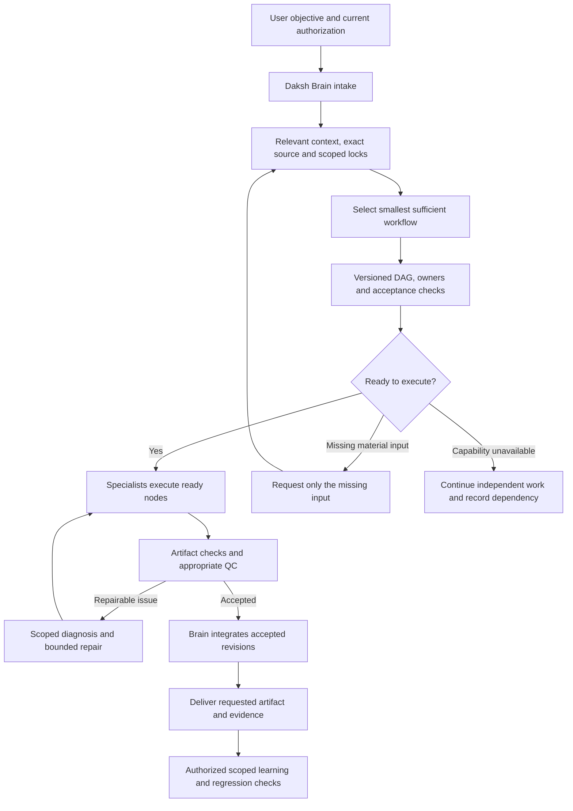
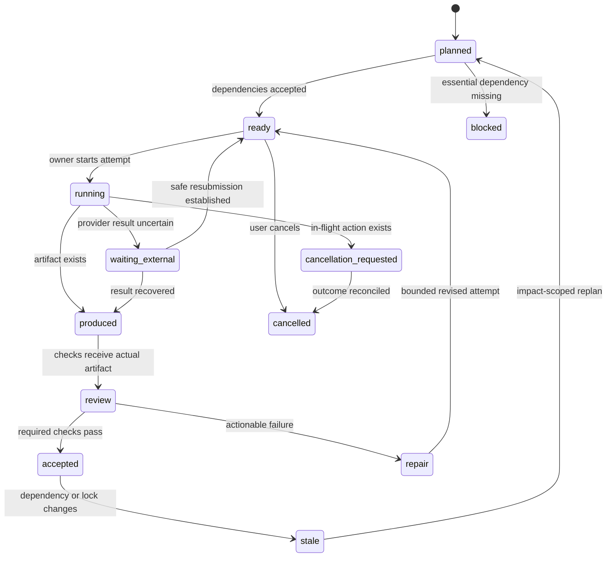
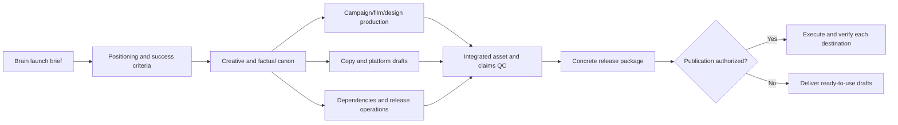
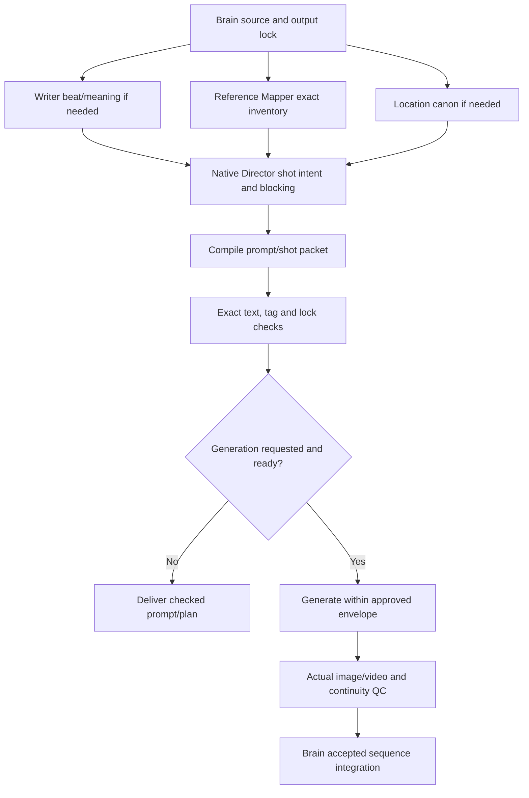
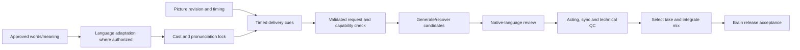

# Daksh Brain workflow system

This is the target operating design for coordinated work. **Daksh Brain is the single accountable orchestrator.** It owns intake, routing, dependency order, current canon, budgets, acceptance and the final user response. Specialist agents execute bounded assignments. `maniik-advisor` contributes founder judgment, voice and strategic challenge under Brain; it is not a second command hierarchy.

These workflows do not establish a running service, installed agent, connected provider, approved asset, scheduled job or spent generation credit. Existing skill source and the applicable current user instruction remain the execution contract. New capability roles are designed responsibilities until implemented and verified. Read [HANDOFFS_AND_QC.md](HANDOFFS_AND_QC.md) for the artifact, revision, QC and recovery protocol.

AI-film adds three pinned-module workflows: `ai-film-production`, `ai-film-viral-studio` and `ai-film-mann-edit`. See [the integration guide](AI_FILM_INTEGRATION.md) for executable commands, source mapping and preserved owner gates.

## 1. One orchestration loop

The loop scales down. A one-line dubbing adjustment may use Brain → Dubbing → line check → answer. It does not need Research, Music, Socials and an elaborate production meeting. A full multilingual film launch needs a dependency graph and several specialist handoffs.

Brain may delegate planning detail, but only Brain changes the authoritative task plan and resolves conflicting outputs. A specialist cannot reinterpret a request to add publication, paid generation, new recipients, a new provider or a different creative direction.

## 2. Intake that prevents the wrong work

Brain builds a task brief from the current request and already available context. It does not repeatedly ask for information the user supplied earlier.

| Brief field | Resolve at intake | If absent |
|---|---|---|
| Desired artifact | Prompt, corrected image, storyboard, audio, software change, research, deck, caption or operational action | Infer from the request; clarify only when alternatives materially differ |
| Use and audience | Production, review, personal use, internal decision or public release | Choose a conservative format suitable for the stated objective |
| Scope | Project, episode, scene, shot, asset, language, platform, repository and branch where relevant | Use the narrowest defensible scope |
| Current source | Accessible files, frame pixels, script, data export, code revision and approved reference | Retrieve relevant connected/local evidence before asking |
| Protected canon | Exact words, identity, tags, geometry, clothing, brand text, timing and approved versions | Carry existing approved locks forward; label genuine gaps |
| Allowed change | What the user wants changed and whether experimentation is allowed | Do not turn a narrow correction into a redesign |
| Output contract | Count, language, duration, dimensions, layout, file type and delivery location | Choose useful defaults from the applicable skill |
| Action envelope | Read, edit, generate, send, publish, schedule, push, deploy and spend authorization | Execute implied reversible work; obtain only truly missing authorization |
| Resource envelope | Deadline, paid-call/credit cap, concurrency, maximum repair effort | Stay within existing approval; do not silently raise cost or model tier |
| Acceptance | Observable conditions that make the result usable | Define checks appropriate to the artifact |

Do not treat a task name, remembered image description, historical URL or old provider ID as proof that the source can be accessed now. A context-only task may proceed without a source file; a pixel-preserving image edit cannot.

### Authority and version selection

Use the latest explicit user request first. Within the remaining scope, preserve approved shot/scene/asset exceptions, the current approved source and project versions, then applicable saved rules. Keep global, project, scene, shot, asset, language and model scopes separate. A shot-level motorcycle placement, poster treatment or eyelid change does not rewrite the whole project.

Existing consolidated dossiers contain older source modules as well as newer overlays. Read the applicable current overlay before copying an old example. In particular, the V5.1 Native Director and Socials overlays supersede conflicting older examples. Brain records the resolution when it affects execution.

## 3. Execution gates and task states

Gates are checks, not an automatic series of user approval requests. Existing valid authorization and approved masters are reused. A gate becomes a user question only when an essential fact, approval or irreversible choice is actually missing.

| Gate | Owner | Pass condition | Failure handling |
|---|---|---|---|
| G0 — objective | Brain | Desired artifact, scope and action envelope are understood | Resolve from context; ask one focused question only when necessary |
| G1 — source and canon | Brain + domain owner | Required sources accessible; revisions and locks identified | Retrieve missing evidence; keep dependent work waiting |
| G2 — capability and plan | Brain + `capability-operator` | Real tool support, budget and dependencies established | Choose a supported route, prepare offline artifacts or report a concrete blocker |
| G3 — execution readiness | Node owner | Inputs accepted; node has one owner, output contract and bounded attempts | Reject incomplete handoff before costly work |
| G4 — acceptance | `independent-qc` or clearly labelled self-review | Required content, technical and actual-artifact checks pass | Diagnose failure and repair only affected nodes |
| G5 — delivery/action | Brain | Final bundle matches request; requested external action is authorized | Complete authorized action and verify receipt; hold only the missing part |
| G6 — learning | `knowledge` + `brain-evals` under Brain | Explicitly authorized update is scoped, persisted and validated | Keep a proposed lesson pending; do not claim a saved rule |

Node states:

`accepted` describes internal acceptance against specified checks. User creative approval, publication, scheduling and deployment are separate recorded events. A worker dispatch or a valid JSON file is not a produced media asset.

## 4. Workflow selection and role ownership

| Mode | Trigger and lead | Supporting roles only when needed | Typical output |
|---|---|---|---|
| Launch | Multi-asset product/film/campaign launch; Brain | `maniik-advisor`, `business-strategy`, `research-intelligence`, creative owners, `socials`, `operations`, `independent-qc` | Versioned launch package and release checklist |
| Film/storyboard | Scene, frame, shot or video direction; `native-director` | `writer`, `reference-mapper`, `location-director`, `action-style`, `dubbing-director`, `music-director` | Shot plan, prompts, inspected boards/video when generated |
| Connected locations/props | Coherent set, directional views, exact inventory; `location-director` | `research-intelligence`, `reference-mapper`, `native-director` | Location bible, view/tag mapping, reference assets |
| Dubbing | Speech performance, multilingual cues or audio; `dubbing-director` | `writer`, `native-director`, language reviewer, `independent-qc` | Exact tagged line or cue/take/release bundle |
| Music | Score, lyrics, song or instrumental; `music-director` | `suno-helper`, `writer`, `native-director` | Composition, paste-ready prompt, inspected audio if generated |
| Fashion | Editorial, lookbook or campaign visual system; `fashion-campaigner` | `location-director`, `native-director`, `socials` | Hero/supporting prompts or generated campaign assets |
| Socials | Captions, posts, calendar or analytics; `socials` | `research-intelligence`, `design`, `data-analytics`, `independent-qc` | Platform-native copy, draft calendar or evidence-based analysis |
| Engineering | Feature, bug, integration or code review; `engineering` | `design`, `research-intelligence`, `capability-operator`, `independent-qc` | Working scoped change and validation evidence |
| Research | Question, current tools, comparison or `gm`; `research-intelligence` | Domain owners, `business-strategy`, `maniik-advisor`, `independent-qc` | Ranked evidence-backed recommendation |
| Business | Strategy, positioning, monetization or decisions; `business-strategy` | `finance`, `sales`, `legal`, `people`, `research-intelligence` | Decision memo, assumptions and execution plan |
| Documents/data | Report, deck, sheet, dashboard or analysis; `documents` / `data-analytics` | Domain owner, `design`, `independent-qc` | Usable artifact and source/method evidence |
| Operations | Schedules, support, process or recurring work; `operations` | `support`, `sales`, `people`, `capability-operator`, `knowledge` | Executed authorized change or concrete operating plan |
| Learning/maintenance | Explicit update, regression or capability maintenance; `knowledge` | `brain-evals`, affected owners, `engineering` | Scoped persisted lesson and verification result |

An agent role, skill package and external connector are different things. A named `finance` role can reason about a supplied budget without implying a connected bank account. `writer` remains a documented/reconstructed role where the original installed source is unavailable; Brain must not claim to have recovered it.

### Machine-readable template catalogue

[architecture/workflows.json](../../architecture/workflows.json) contains 27 design-time DAG templates. They support offline plan/route inspection; they do not automatically run tools, spend credits, create schedules or publish assets. The conceptual flows below explain how Brain adapts those templates to a real task. Optional branches are removed when the request does not need them.

| Template ID | Relevant flow in this document |
|---|---|
| `direct-task` | Smallest-sufficient loop and fast paths |
| `full-launch` | Launch |
| `screenplay-to-film` | Film/storyboard/video |
| `connected-locations` | Connected locations/props |
| `exact-tag-inventory` | Preview-by-preview exact-tag route |
| `dialogue-dubbing` | Dubbing |
| `music-score` | Music/song/score |
| `suno-instrumental` | Compact instrumental prompt |
| `fashion-campaign` | Fashion |
| `social-content` | Socials/content/analytics |
| `engineering-change` | Engineering |
| `research-blueprint` | Research/God Mode |
| `business-validation` | Business decision and experiment |
| `document-package` | Native document/sheet/deck |
| `data-analysis` | Data definitions, analysis and decision |
| `work-planning` | Source-backed Operations planning |
| `season-batch` | Film + Dubbing + Music with batch canon locks |
| `competitor-response` | Research + Business + authorized Socials response |
| `script-voice` | Writer + Dubbing without unnecessary visual production |
| `multi-show-sprint` | Launch/Operations with isolated project canons |
| `image-edit` | Exact source/frame/identity route with actual image output |
| `memory-update` | Scoped learning and regression |
| `sales-research` | Account research, qualification and reviewed draft without sending |
| `support-triage` | Knowledge-backed triage and reviewed response |
| `legal-review` | Jurisdiction-aware source review and legal draft without signing |
| `people-planning` | Organizational planning from authorized context |
| `design-handoff` | Brief/reference to reviewed design and implementation handoff |

### Composite production modes

**Season batch:** lock shared show canon, cast/voice mappings, language matrix and picture/script dependencies before batching episodes. Brain can parallelize independent episode preparation and language review. Each cue/take remains bound to its own episode and picture revision; a global glossary correction invalidates only consumed pronunciations. Perform per-episode checks plus cross-episode motif, voice, costume and geography continuity. Keep production queues inside the approved credits/call/concurrency envelope.

**Multi-show sprint:** maintain a separate canon, source namespace, budget ledger and accepted-artifact manifest per show. Shared tools and specialists can be reused; characters, tags, voice IDs, motifs and proprietary source cannot leak between shows. Brain prioritizes ready work by actual deadline/dependency and reserves integration/QC capacity. A sprint plan is not proof that recurring jobs were created.

**Competitor response:** Research verifies the competitor event and separates observed facts from interpretation. Business identifies whether responding serves a real user objective. Socials/Design create an accurate, original response only if useful; QC checks claims, confidentiality and brand/voice fit. Drafting a response does not authorize public posting or outreach.

**Script and voice only:** Writer locks the requested script/meaning, then Dubbing prepares/performs approved cues with language/performance checks. Do not automatically commission a storyboard, location set or score. If final picture timing does not exist, label timing as provisional and avoid claiming final lip sync.

**Reference image edit:** bind the actual source pixels, edit target, protected identity/garment/geometry/crop/text and allowed variable. Perform the requested edit with a supported actual editing tool, inspect the result and compare protected regions. A prompt for an edit is not the completed edit. Preserve original pixels for requested layout-only changes when that is the task's contract.

## 5. Launch workflow

**Inputs:** objective and audience, launch object, truthful product/project facts, source assets, channels, deadline, approved brand/creative locks, owners and action/cost envelope.

1. Brain defines the concrete release: what is launching, to whom, through which requested deliverables and what success would mean. `maniik-advisor` can challenge positioning; Brain decides the plan.
2. `business-strategy` and Research resolve material claims, audience needs and practical feasibility. Unknown demand or performance is an assumption, not a launch result.
3. Creative owners lock a shared release version: title/product naming, visual identity, supplied facts, rights/permissions where relevant, intended languages and destination formats.
4. Independent production branches work from that version. Socials may draft from approved concept and facts while final images render; final caption claims are checked against the selected final images.
5. Operations compiles destination, owner, deadline, dependency, rollback and receipt requirements. No timer, post, email or deployment is created merely because it appears on the checklist.
6. QC checks the complete user-visible bundle, including thumbnails, public fields, links, captions, attachments and accessible formats.
7. Brain integrates, delivers and performs only already authorized external actions. Record exact action receipts and destination state.

**Outputs/evidence:** launch brief, artifact/version manifest, final assets or drafts, channel copy, unresolved decisions, QC results and observed release receipts. Metrics start as a measurement plan; replace them with dated observations only after actual data exists.

**Recovery:** a changed product claim invalidates affected copy and public fields; a changed hero image invalidates its crop/alt-text/caption checks. It does not automatically regenerate the whole campaign.

## 6. Film, storyboard and video workflow

**Inputs:** current screenplay/beat, supplied scene/shot IDs, exact spoken words, actual reference frames, cast/costume references, prop states, location/view tags, timing, camera locks and requested output form.

1. Read the actual scene, each relevant saved shot prompt and each bound tag/reference. An overview card alone is insufficient for an exact storyboard/tag audit.
2. `reference-mapper` distinguishes opening frame, ending frame, identity, costume, prop and architecture references. It records frame-local visible inventory, partial owners/reflections and offscreen audio separately.
3. `native-director` assigns one readable purpose to each shot. A still depicts one physically possible instant; a video prompt can sequence actions with timings. Preserve supplied shot IDs without inventing look-alike IDs.
4. If a screenshot/reference frame accompanies a video-prompt request, apply the current implicit strict frame-match rule unless the user authorizes composition/blocking/camera changes. Preserve crop, angle, camera height, positions, background, lighting and focus relationships.
5. Choose shortcut scope precisely: `pm` strict prompt match; `fm` frame-compatible motion; `fc` frame correction; `fx` scoped fix; `dh` delivery; `ah` acting/action; `ch` motivated camera; `se` experiments on unlocked variables. A shortcut never cancels a static-camera or strict-reference lock. `fc` must not be confused with the Fashion Campaigner role.
6. On unlocked work, explore story-motivated composition and light rather than applying the same OTS/thirds/foreground-blur recipe everywhere. On narrow fixes, preserve format and unrequested elements.
7. Compile executable tags directly into the prompt. Do not add a standalone `Refs (continuity)` line unless requested. Exact location orientations and visible subjects must agree with prose, not only the tag list.
8. For video prompts, all final `DIALOGUE: @character: "..."` lines follow every action, camera, audio and visual-reference instruction, separated by a blank line. Nothing follows the final dialogue. Preserve wording, punctuation and order. Apply the current scoped delivery-tag refinement rule without silently rewriting the approved words.
9. Run text checks first. If generation is requested, inspect the actual image/video before claiming identity, frame match, anatomy, temporal consistency, geography or lip-sync success.
10. Integrate the sequence with entrance/exit direction, 180-degree axis, eyelines, prop state, continuity and reveal timing checked across adjacent shots.

**Source-specific locks:** load the relevant project exception register. Blind-state behavior, audience-only characters, exact cast tokens, approved crowd visibility, a delayed creature reveal and local poster exceptions remain scoped. This generic workflow does not make those conditions defaults for unrelated stories.

**Outputs/evidence:** scene/shot coverage matrix, exact prompt revisions, reference binding table, selected generated artifacts when requested, per-shot QC and sequence continuity review. A default full board uses the applicable source layout; do not fill insufficient story coverage with invented next-scene beats. Cell aspect ratio and sheet pixel dimensions are separate fields.

**Recovery:** a narrow camera/hand/prop correction modifies only that shot and proven dependent continuity. Missing reference pixels block a claimed exact visual edit; checked text preparation can still proceed. `fx c` requires actual representative cinematic reference images before its composition prompt, rather than text diagrams pretending to be previews.

## 7. Connected location, prop and exact-tag workflow

**Inputs:** story use, region/period, actual location/prop references, approved master if any, scene links, known zones, scale anchors, orientation conventions, exact live-preview tags and desired views.

1. Select the smallest applicable route: **master-first**, **researched location**, **derive connected view**, **props-only**, or **read-only tag inventory**. A props-only task does not authorize a new environment master. Reuse a valid approved master instead of requesting its approval again.
2. For new location design, Research supplies concrete regional anchors: architecture, materials, utility placement, weathering and everyday use. Avoid a generic “rural village” label when the brief specifies a particular region.
3. Location defines permanent geometry, world light direction, entrances, connectors, landmarks, walk routes and object states. Record a zone/view map before deriving independent angles.
4. Obtain the source-required master approval when genuinely absent. Derive reverse/side/top/ground views from that master. Do not mirror an image to fabricate an object reverse or silently move a door to improve composition.
5. For default props turnarounds, supply separate square photorealistic neutral-grey studio reference photographs: Front, Back, Left and Right, full object visible, consistent material, scale, design and markings. Extra macros supplement the requested primary views.
6. Keep intrinsic object front separate from world direction and scene placement. Empty/full, open/closed and damaged/intact are state variants, not new permanent designs. A studio reference background is not an in-world set.
7. For exact tag collection, open every requested item and inspect every required preview/view. Record the exact displayed tag, parent location/sublocation, orientation, associated scenes and preview evidence. Cast/costume and prop inventories require their own preview verification. Re-read current UI state after preview transitions; do not infer tags from overview metadata or expected suffixes.
8. Check connected views against anchors, routes, light and scale. A high-angle image is not automatically a true top-down/nadir view; an image bearing “360” is not a tested panorama.

**Outputs/evidence:** location bible, zone map, camera/view index, prop-state table, reference photographs/prompts as requested, exact tag CSV and location-to-scene mapping. For panorama delivery, distinguish schematic plan, render, enhanced image, panorama texture and viewer-tested panorama.

**Recovery:** mark preview-unverified items explicitly and continue verified portions; do not invent completion counts. If interactive control is unavailable, provide a concrete capability blocker. A new master revision invalidates dependent views according to the dependency ledger; a crop-only change need not invalidate world geometry.

## 8. Dubbing and speech workflow

**Fast path:** for an ordinary one-line tone/pace change, reuse approved line, speaker, language, voice/model and delivery context. Return one best-fit tagged line without an unsolicited plan, alternatives or research. Change the requested performance dimension: faster is not automatically louder, and crying is not automatically slower.

**Production inputs:** locked script and language meaning, picture cut/revision, timebase and cue boundaries, cast/voice mapping, pronunciation glossary, overlaps, performance intent, output format, account/tool availability and cost envelope.

1. Keep canonical approved spoken text, tagged/render text and provider payload as separate fields. Never change canonical spelling as an undocumented pronunciation trick.
2. Adapt language only when authorized. Preserve meaning, voice, interruption, order, intentional overlap and supplied timing. Use the project's actual language matrix rather than assuming every supported language is required.
3. Validate actual endpoint/interface, voice ID, language variety, model support and format. A UI option does not prove an API field. A remembered provider account is not current access.
4. Use sparse, meaningful vocal direction; clean dialogue tagging does not gain environmental SFX. Natural-language tags are intent, not guaranteed synthesis controls.
5. Fingerprint the request from canonical text revision, tagged text, picture/cue revision, voice/config and source hashes. Persist the provider request ID before another attempt where supported.
6. Inspect/listen to actual takes. Separate native-language accuracy, acting, timing/lip sync and sound technical checks. ASR can assist text mismatch detection; it does not replace acting or native review.
7. For a failed cue repair cycle, use the existing default of **at most two new candidate attempts** unless the approved project budget differs. Diagnose both failures before another budget decision. Query uncertain paid-request status before resubmitting.
8. Select the accepted take and preserve its file/hash, cue fingerprint, version and review receipts. Redub only cues/languages invalidated by actual dependency changes.

**Outputs/evidence:** exact line where requested, or casting record, glossary, cue sheet, request/take manifest, selected audio files, native/acting/sync/technical reviews and release metadata. Metadata completeness alone is not audio approval.

## 9. Music, song and instrumental workflow

**Inputs:** requested artifact (lyrics, score plan, paste-ready prompt or generated track), scene/picture revision, emotional timeline, duration, dialogue space, instruments, language, approved lyrics/hooks, exclusions and any field budget.

1. Choose music-only, song/lyrics, video-to-music, SFX or analysis deliberately. Do not add SFX or source-audio analysis to an ordinary music-only request.
2. `music-director` spots emotional and edit beats: motif entry/exit, rise, silence, reveal, transition and dialogue ducking. Keep musical direction separate from implementation/provider settings.
3. For lyrics, check idiom, meaning, point of view, prosody, rhyme, breath and character continuity. Preserve locked words/hooks; a changed ending does not authorize rewriting the opening.
4. For instrumental-only work, exclude vocals, choir, chants, humming and sung alaap as applicable. Do not smuggle vocals into texture descriptions.
5. `suno-helper` compresses an instrumental Styles prompt only when that output is requested. The usual **≤800-character limit is a saved user/editorial cap**, not a verified provider maximum. A current explicit task cap overrides it. Count actual pasteable text, retain the emotional arc/instruments/exclusions and remove optional adjectives first.
6. Verify current provider-specific controls and actual account availability only when execution depends on them. Do not copy one platform's fields or limits into another.
7. Generate only within the approved envelope. Listen to the actual track and inspect duration/edit points before claiming musical, vocal, mix or timing quality.

**Outputs/evidence:** cue/spotting map, lyrics or composition direction, exact paste-ready field text and character count, settings actually used, actual audio where generated, selected take and listening review. A local sad opening → epic reveal → flute tail direction remains local to its brief.

**Recovery:** revise the failed musical section or prompt constraint; preserve approved hooks and unaffected sections. Avoid promising deterministic stems, timing or composition control that the actual interface does not provide.

## 10. Fashion campaign workflow

**Inputs:** product/garment photos and facts, accessible model references, brand context, location, mood/season, output count, aspect ratio, approved looks and allowed changes.

1. `fashion-campaigner` chooses one visible controlling idea and a campaign visual system: styling, palette, light family, medium/grade, hair/makeup and shot functions.
2. Lock garment design, cut, fabric, color, pattern, hardware and requested branding. Keep model facial identity and photorealistic detail from the supplied reference. Do not infer real identity or sensitive traits from the image.
3. Default to **one hero plus two or three supporting shots** only when count is unspecified. Explicit count wins. Each support shot needs a distinct purpose: scale, interaction, portrait, texture or a useful vantage.
4. Every standalone prompt repeats required identity, garment, location and light locks. One frame has one dominant action; natural pose/contact points must be physically plausible.
5. Differentiate unlocked shots through useful camera/pose/scale choices without changing approved cast, garment or world. A detail crop does not require widening to reveal an off-frame face.
6. Route to Location only for actual spatial/prop work, Native Director only for requested video/storyboard execution, and Socials only for requested copy. Still-only campaigns do not require every role.
7. For requested image edits/generation, inspect real source pixels and actual output. Preserve a no-crop/frame constraint and authentic requested logos/text. Do not automatically erase branding with a generic negative prompt.

**Outputs/evidence:** title/concept, look and visual-system locks, assumptions, purpose-labelled standalone prompts or actual assets, per-shot reference bindings, garment/identity/text/composition QC and final count.

**Recovery:** an approved garment change invalidates affected prompts/assets; changing a caption does not. Study counts and performance claims in imported heuristic sources remain unverified unless independent evidence is available.

## 11. Social publishing, copy and analytics workflow

**Copy fast path:** `caption do` → one Instagram-ready caption. Current `captions do` → six platforms in **five delivery groups**: X, LinkedIn, Pinterest Title + Description, one shared Instagram/Facebook caption and WhatsApp. Explicit platform, count, language and revision instructions win. “2 captions” defaults to two Instagram options; shortening an existing set revises that set.

**Campaign inputs:** factual asset context, actual final/source visuals where material, audience, goal, platform, voice, publication permissions and real metrics/exports when analyzing results.

1. Separate researcher, social writer/manager and evaluator roles on substantial campaigns. Keep actual independent review distinct from same-context self-review.
2. Draft hooks and platform-native copy in the approved voice. Preserve team credit, confidentiality and truthful ownership. No invented results, user counts, project approval or client affiliation.
3. Recheck current factual/tool/trend claims and relevant platform limits. X weighted character counting is not plain string length. Treat saved limits as dated until verified for a task that depends on them.
4. Inspect every public field: caption, Pinterest title/description, first comment, thumbnail, link, alt text and attachment where applicable. A safe caption cannot compensate for an unsafe image.
5. Use the existing substantive Socials rubric where applicable: six scores at least 7, confidentiality 10 and no blockers. Allow at most two revision cycles under that workflow, then expose remaining issues. These thresholds are not universal thresholds for other domains.
6. Keep draft, approved, scheduled and published separate. Prepare complete copy before seeking a genuinely missing publication decision. If publication was already explicitly authorized, execute and verify it.
7. Analyze only observed metrics with a clear period, definition and denominator. Caption support on six platforms does not imply six live analytics adapters. Pinterest/WhatsApp copy support does not prove connected analytics.

**Outputs/evidence:** exact requested copy, or campaign calendar/draft manifest; source/claim checks; character counts where needed; evaluator result; actual publication receipts when authorized; experiment design and observed measurements kept separate.

**Image-specific handling:** when a collage/layout must preserve original-photo pixels, use the actual selected photos and protect identities/backgrounds/crop. A remembered face description is not an editable photo source.

## 12. Engineering and integration workflow

**Inputs:** expected behavior, current failure/reproduction where relevant, repository/branch, existing instructions, scope, acceptance conditions, deployment target and allowed actions. For a genuine greenfield project, begin implementation with sensible defaults; do not invent existing code to inspect.

1. Brain defines the smallest coherent change and specialist ownership. `engineering` checks relevant current source, state and instructions, preserving unrelated work.
2. Build a reproducible failure or concise behavior contract. Current claims about frameworks, SDKs, APIs, limits or cloud behavior require the applicable installed/current official documentation when material.
3. Resolve real integration capabilities before binding a provider SDK or promising connected service behavior. A local UI stub may be a deliberate prototype artifact, but cannot be reported as a provisioned production integration.
4. Implement in isolated files/branches as appropriate. Parallel agents own disjoint paths; dependent edits integrate sequentially. Record decisions that shape behavior rather than creating an unnecessary architecture essay for a small fix.
5. Validate proportionately: type/build/static checks, targeted behavior tests, integration checks and manual/UI verification as required by the change. Avoid tests that merely restate a reversible formatting edit.
6. `independent-qc` reviews changed behavior, failure paths, data handling and unresolved risks. Document which checks actually ran and which were unavailable.
7. Complete the user's authorized Git action. Before pushing, confirm the intended repo/ref and inspect the resulting diff. Before deployment, prepare the concrete reviewable result and apply any actually required approval. Verify remote commit/deployment state after the action.

**Outputs/evidence:** working change, relevant docs, diff/commit, checks and results, known limitation and observed remote receipt. A successful build is not proof that a private external integration is configured or that a running API is healthy.

**Recovery:** preserve the user's work, scope rollback to the change, reconcile interrupted commands before rerunning and check actual service state. Retrying a failing install indefinitely does not establish progress.

## 13. Research and God Mode workflow

**Inputs:** decision/question, audience, depth, constraints, internal context and freshness needs.

1. Select the research mode: quick current fact, comparative recommendation, deep parallel evidence, internal scan or build-oriented discovery. The existing `god-mode` scanner and skill retain their source behavior subject to the new Brain-first hierarchy.
2. Perform relevant internal retrieval first. Use available project knowledge and artifacts without exporting private names, links, identifiers or raw records into public search.
3. Research independent tracks when useful: capabilities/tools, architecture, practical techniques, prior art and business feasibility. Use current primary sources for technical assertions; record publish/verification dates and distinguish observation from inference.
4. Resolve conflicting evidence and expose material limitations. A vendor claim, a benchmark, a hypothesis and a tested local result are separate evidence types.
5. Deliver a ranked recommendation with why it is strongest, practical next actions and a meaningful alternative only when useful. Do not hide behind an unranked tool list.
6. In build mode, convert the chosen design into actual scoped implementation, validation and authorized repository delivery. A research document alone does not complete an explicit build request.

**Outputs/evidence:** question/constraints, dated source table, findings, ranked decision, assumptions/gaps and implementation plan or actual build as requested. God Mode changes research depth and initiative; it does not bypass source locks, spending limits or action authorization.

## 14. Business, finance, sales, legal and people workflow

**Inputs:** decision to make, business stage, audience/customer context, supplied actual figures, constraints, horizon and intended deliverable.

1. `business-strategy` frames a concrete decision and success criterion. `maniik-advisor` can provide founder/persona perspective and challenge assumptions; Brain owns the final recommendation.
2. Research validates material market/current facts. Separate actual customer evidence, supplied numbers, modeled assumptions and hypotheses.
3. Route only needed specialties: `finance` for modeled economics/budgets, `sales` for pipeline/proposals, `legal` for relevant obligations/terms, `people` for staffing/roles. Specialist naming does not imply external account access or professional signoff.
4. Build explicit scenarios and sensitivity: what changes the recommendation, what inputs are missing and how uncertainty affects the decision. Do not invent a precise forecast from weak inputs.
5. Produce the usable decision artifact: recommendation, priorities, owners, sequence, measurable checkpoint and unresolved dependency.
6. External outreach, contract execution, payments, account changes and messages require their actual action authorization. A strategy brief authorizes analysis and preparation, not automatically sending it to others.

**Outputs/evidence:** decision memo or operating model, source/assumption ledger, reproducible calculations, downside/alternative, execution milestones and only observed action receipts.

### Sales research and draft (`sales-research`)

**Inputs:** target account/person or market segment, business objective, authorized CRM/company context, offering facts, qualification criteria and intended draft channel.

**DAG:** Brain → Research/account evidence → Sales qualification and outreach draft → independent factual/voice/permission review → Brain delivery.

`sales` separates observed account needs from hypotheses and verifies material public/current claims through Research. Use connected records only when actually available and authorized; a sales role does not imply a CRM, enrichment service or email account is connected. Produce a concrete account brief, evidence-linked fit assessment, relevant offer and tailored draft. Never invent a relationship, buying signal, customer result or person's contact details. The workflow ends with a reviewed **draft**; it does not send outreach or mutate a CRM unless the user separately authorizes that action.

**Outputs/evidence:** dated account sources, qualification assumptions, concise recommended next step and reviewed message/proposal draft. Missing evidence becomes an explicit research gap, not false personalization.

### Support triage (`support-triage`)

**Inputs:** reported issue, user-authorized account/system context, accessible knowledge/policy sources, observed symptoms, severity and allowed remedy scope.

**DAG:** Brain → Knowledge source/revision retrieval → Support triage and response draft → independent correctness/remedy review → Brain delivery.

`support` distinguishes customer-reported symptoms, verified system facts, likely cause and confirmed cause. `knowledge` supplies the applicable current policy/runbook with provenance; old policy or inaccessible account data cannot be treated as current. Prepare the best supported response and concrete troubleshooting/remedy steps. Escalate a genuinely unresolved issue with a compact evidence packet; do not promise refunds, access changes or a resolution unsupported by policy and authority.

**Outputs/evidence:** issue/severity summary, source-linked diagnosis, performed-versus-proposed checks, reviewed response and escalation packet if needed. Customer messaging and account mutations require actual explicit task authorization; preparation alone does not send the response.

### Legal review (`legal-review`)

**Inputs:** document/decision, intended use, relevant jurisdiction, parties/context supplied by the user, requested review scope and known deadlines.

**DAG:** Brain → jurisdiction/current-authority research → Legal issue analysis and draft → independent source/scope review → Brain delivery.

`legal` identifies the applicable jurisdiction and current authoritative sources before making material legal claims. Retrieve relevant supplied terms and evidence; do not assume a governing law from a company name or generic template. Separate document facts, legal authority, interpretation, uncertainty and items requiring qualified counsel. Produce the requested clause review, risk memo or draft with specific changes and their purpose. No automatic signing, filing, legal representation, contract acceptance or professional approval is implied.

**Outputs/evidence:** jurisdiction/scope statement, dated authoritative references, issue-to-clause mapping, reviewed draft and material unresolved legal questions. If essential jurisdiction or document context cannot be inferred/retrieved, ask for that missing input while completing independent preparation.

### People and organizational planning (`people-planning`)

**Inputs:** organizational objective, team/role constraints, workload or skills context the user is authorized to use, planning horizon and requested artifact.

**DAG:** Brain → authorized-context and source review → People role/capacity/process plan → independent evidence/fairness/scope review → Brain delivery.

`people` focuses on role clarity, capacity, responsibilities, onboarding, collaboration and process design. Use only relevant authorized context; avoid sensitive-trait inference, fabricated performance facts and unsupported personal conclusions. Distinguish observed workload from estimates and compare organization/process alternatives. This workflow does not make or execute high-impact personnel decisions such as hiring, firing, compensation or promotion. Where the request approaches such a decision, provide factual, job-relevant process support and identify the human decision owner.

**Outputs/evidence:** organizational goal, source/assumption ledger, role/responsibility or capacity plan, implementation checkpoints and reviewed limits. No HR system access, employee notification or account change is claimed without actual tools and authorization.

## 15. Documents, data and dashboards workflow

**Inputs:** audience and question, accessible source documents/data, definitions, requested artifact/file type, style/reference, data period and delivery destination.

1. `documents` or `data-analytics` inventories sources and defines the result. Read provided references instead of replacing their facts with generic content.
2. Record dataset grain, period, units, missingness, duplicate handling, metric definitions and denominator. Derived estimates remain labeled; no invented measurements or silently filled business facts.
3. Analyze reproducibly where calculations matter. Keep raw data access and output sharing scoped to the user request.
4. Author the actual requested document, deck, sheet, PDF or dashboard with the appropriate native artifact tools/runtime. A Markdown outline is not a finished slide deck or spreadsheet unless explicitly requested.
5. Inspect rendered pages/slides and table/plot clarity. Check spreadsheet formulas, ranges, totals, formats and meaningful edge cases; check interactive dashboard controls against actual data.
6. Validate citations/source claims and protect required text/branding. Distinguish professional polish from factual verification.

**Outputs/evidence:** usable native artifact, relevant source/definition notes, method or query, key findings, render/function checks and known material limitations. Do not publish a dashboard externally merely because it was built.

### Design and implementation handoff (`design-handoff`)

**Inputs:** user objective, audience, accessible brief/reference assets, existing brand/component constraints, target surface, required states, accessibility needs and requested delivery format.

**DAG:** Brain → reference/requirements interpretation → Design exploration and chosen design → independent usability/accessibility/reference QC → Brain design handoff delivery.

`design` turns the brief into a coherent visual/interaction system while preserving supplied text, branding, identity and scope. Specify hierarchy, composition, behavior and meaningful loading/empty/error states where relevant. Separate reference inspiration from exact-match requirements. Use actual available authoring/rendering tools; a description is not a finished design file when the task asks for one. If implementation is requested, hand accepted design requirements and assets to `engineering`; otherwise deliver the design package without inventing a code change or deployment.

**Outputs/evidence:** actual requested design artifact, relevant assets/tokens/component specifications, interaction/state notes, reference-comparison and accessibility/usability review, and concrete implementation acceptance checks. Tool/account connections and prototype interaction remain unverified until actually observed.

## 16. Operations, support and recurring work

**Inputs:** operational objective, actual current state, responsible account/system, timezone, recipients/destinations if needed, recurrence/notification intent and action envelope.

1. `operations` checks current connected state before creating duplicate schedules, calendar items or automations. A dated scheduler snapshot is not current scheduler evidence.
2. Prepare the exact change: purpose, target, timing, payload, owner, stop condition and success/failure notification. Use the user's timezone for user-facing schedules.
3. Preserve existing separate owners/cadences unless the request authorizes change. Do not resume a paused agent, timer or missing Writer job under general “learn/update” wording.
4. Use the actual scheduling/task tool available. A reminder is not a calendar meeting, and a checklist is not a created automation.
5. For monitors, keep quiet while unchanged/non-actionable unless periodic updates were requested. Notify on meaningful change, completion, failure or needed user action.
6. For support, distinguish the customer issue, verified account facts, proposed remedy and authorized response. Prepare complete response/artifacts before requesting any genuinely missing send decision.
7. Verify mutation receipts and post-change state. Record timezone, recurrence, next occurrence and scheduler ID where actually returned, without exposing credentials.

**Outputs/evidence:** completed authorized operation or ready-to-execute plan, observed target state, actual IDs/receipts in private execution records, next check and recovery/stop conditions. Historical maintenance times in source snapshots remain history until verified.

## 17. Learning and capability maintenance

1. Capture the correction/outcome with exact source, date, scope and evidence. Classify it as explicit user rule, accepted project decision, observed result, rejected approach, inferred preference or research hypothesis.
2. `knowledge` proposes the smallest affected update: agent instructions, mapped skill, handoff, project exception or evaluation. Do not globalize a local creative choice.
3. Confirm the user actually authorized durable learning/update in the relevant store. A task to document architecture does not automatically authorize edits to external memory, timers or every local skill installation.
4. Update supported source through its prescribed mechanism. Live `brain/DAKSH_BRAIN.json` uses the existing Brain writer with expected revision; do not bypass its concurrency checks with a direct overwrite.
5. Add a meaningful regression case for a new behavioral lock. Run the repository's required selftest/routing and applicable skill checks before claiming validation.
6. Read back persistence and report actual saved paths/versions. Keep proposed, written, validated and activated states separate.

**Outputs/evidence:** scoped lesson, changed files, source provenance, relevant eval case/result and readback. No claim that all account-wide chats, every hidden agent, inaccessible media or external memories were recovered.

## 18. Parallelism, retries and finishing

### Ready-node scheduling

Brain may run nodes in parallel only when their inputs are accepted and their output ownership is disjoint. Research tracks, independent QC and separate caption drafts often parallelize. Canon changes, approvals, dependent edits, commit/push operations and ambiguous paid-request reconciliation remain sequential.

Reserve budget for integration and QC. More agents do not automatically improve quality; avoid duplicating paid generations or asking several workers to overwrite the same file. Specialists return artifacts and evidence to Brain, not competing final claims to the user.

### Failure and cancellation

Use the detailed retry matrix in [HANDOFFS_AND_QC.md](HANDOFFS_AND_QC.md). In every workflow: diagnose before retrying, bound attempts, retrieve uncertain external results before duplicate submission, preserve approved work, and cancel only pending/affected work. Cancellation of an in-flight provider call is a requested action until confirmed; it does not guarantee a credit refund.

### Synthetic dispatch examples

These examples contain invented placeholders and are not recovered production records.

| Request | Brain's smallest sufficient route | Completion evidence |
|---|---|---|
| “Is supplied frame ka video prompt do; camera same rakho” | Brain → Mapper → Native Director → lock/text checks | Same frame scope, executable references, permitted motion, final exact dialogue block |
| “Sirf is line ko tez aur dabe gusse mein bolo” | Brain → Dubbing → exact-word/delivery check | One revised tagged line; no claimed audio generation |
| “Town set ke sab directional tags CSV mein do” | Brain → Location/Mapper → preview-by-preview audit → QC | Exact preview-derived tags, view/location/scene mapping, unverified rows explicit |
| “Approved jacket se 4 campaign photos aur captions” | Brain → Fashion → authorized generation/QC → Socials → integration | Four real inspected images, protected garment/model, copy for requested platforms |
| “Feature fix karo aur isi repo pe push karo” | Brain → Engineering → applicable checks/review → authorized push | Diff, check results, remote commit/ref verification |
| “Har language dobara mat banao; changed cue fix karo” | Brain → dependency impact → Dubbing only affected cues → QC | Actual invalidation list, bounded new takes and selected-take receipts |

### Definition of done

The requested artifact exists in the correct count, format and destination; protected source and scope are honored; required checks have actually run; requested authorized actions have observed receipts; and material unresolved dependencies are stated plainly. Brain's final response leads with the result, links the usable output and gives only the evidence or limitation the user needs.
